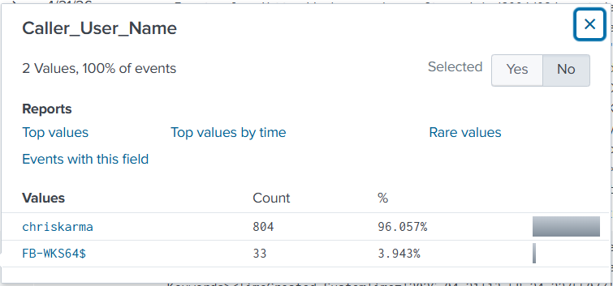

# GhostConnect - TA583 Lab

## **Scenario**

On April 21, 2026, a FedBridge analyst grew suspicious after opening a link in their inbox and later ran a manual antivirus scan that flagged a persistence installer on their workstation. Initial triage revealed unexpected script execution, PowerShell activity, and outbound connections to external servers. You have been provided with endpoint telemetry and recovered browser artifacts. Reconstruct the full intrusion from the initial lure through data exfiltration, surfacing the operator's mistakes along the way.

## **Initial Access**

### Q1: The compromise began on a workstation when a user launched the email client on FB-WKS64. What is the username of the compromised account

Splunk query:

```jsx
index=* "mailto" source="WinEventLog:Security”
```



Answer: chriskarma

### Q2: The user clicked a link inside the email, which spawned a browser. What is the full URL of the delivery page the victim was directed to?

Splunk query:

```jsx
index=* host="FB-WKS64" EventCode=1 Image="*\\chrome.exe" CommandLine"chrome.exe"
| table _time  CommandLine
| dedup  CommandLine
```


Answer: hxxp[://]52[.]59[.]253[.]168/download_invitee[.]php

### Q3: The lure page automatically downloaded a malicious script to the host. What is the full source URL it was originally downloaded from?

```jsx
index=* host="FB-WKS64" "[http://52.59.253.168/download_invitee.php](http://52.59.253.168/download_invitee.php)" ("*.vbs" OR "*.ps1" OR "*.bat")
```


Answer: hxxp[://]52[.]59[.]253[.]168/E-INVITE[.]vbs

## **Execution**

### Q4: Once executed, the dropped script orchestrated the next stage by spawning multiple child processes within seconds. List the two children of wscript.exe in chronological order.

Splunk query:

```jsx
index=* host="FB-WKS64" EventCode=1 Image="*\\wscript.exe" CommandLine="*E-INVITE.vbs*"
```


Splunk query:

```jsx
index=* host="FB-WKS64" EventCode=1 ParentProcessId=12112
|  table _time Image CommandLine ProcessId ParentProcessId
```


Answer: powershell.exe, chrome.exe

### Q5: The next-stage payload was retrieved from a legitimate cloud-hosting service. What is the file ID embedded in that download URL?

Splunk query:

```jsx
index=* host="FB-WKS64" EventCode=1 ParentProcessId=12112
|  table _time Image CommandLine ProcessId ParentProcessId
```


Answer: 1Yqzl-L-1FGWm4iOwieRFv9zr0urEEGWR

### Q6: After extracting the second-stage archive, the user double-clicked the loader executable. What is the full file path of the first-stage loader?

Splunk query:

```jsx
index=* host="FB-WKS64" EventCode=1 FileServer
| table _time ParentImage ParentCommandLine Image CommandLine
```


Answer: C:\Users\chriskarma\Downloads\FileServer\FileServer.exe

## **Discovery**

### Q7: Among the loader's discovery commands, one queried a specific scheduled task by name, likely an OPSEC check to verify a prior footprint. What task name was queried?

Splunk query:

```jsx
index=* host="FB-WKS64" EventCode=1 ParentImage = "*\\FileServer.exe" "schtasks.exe"
| table _time ParentImage ParentCommandLine Image CommandLine
```


Answer: vulntask

### Q8: The loader inspected the ACL on a single file, suggesting preparation for a hijack or overwrite. What is the full path of that file?

Splunk query:

```jsx
index=* host="FB-WKS64" EventCode=1 ParentImage = "*\\FileServer.exe"
| table _time ParentImage ParentCommandLine Image CommandLine
```


Answer: c:\tasks\schtask.bat

### Q9: AD enumeration was performed via a wrapper script that was iteratively re-staged in two different filesystem locations during the operation. List both full paths of adf.bat in the order they appeared.

Splunk query:

```jsx
index=* host="FB-WKS64" EventCode=1 ParentImage = "*\\FileServer.exe" "adf.bat"
| table _time ParentImage ParentCommandLine Image CommandLine
```


Answer: C:\Windows\Temp\adf.bat, C:\Users\chriskarma\AppData\Roaming\adf.bat

### Q10: The wrapper script queried four distinct Active Directory object types using LDAP objectcategory filters. List the four objectcategory values in the order the assembly commands ran.

Splunk query:

```jsx
index=* host="FB-WKS64" EventCode=1 ParentImage = "*\\FileServer.exe" "adf.bat"
| table _time ParentImage ParentCommandLine Image CommandLine
```


Answer: computer,person,organizationalUnit,group

## **Command and Control**

### Q11: After execution, the first-stage loader retrieved and ran a second-stage implant. What is the full file path where it was written to disk and What is the SHA256 hash of the second-stage loader??

Splunk query:

index=* host="FB-WKS64" EventCode=1 ParentImage = "*\\FileServer.exe"
| table _time ParentImage ParentCommandLine Image CommandLine Hashes


Answer:

- C:\Users\chriskarma\AppData\Local\FileR.exe
- 8BAB731AC2F7D015B81C2002F518FFF06EA751A34A711907E80E98CF70B557DB

### Q12: Threat intel links the second-stage loader to a known malware family. What is the family name and its first-seen-in-the-wild date?


Answer: SilentConnect, 2026-03-10 18:48:19

### Q13: One of loaders retrieved an additional payload from a secondary C2 server distinct from the delivery infrastructure. What is the complete URL being fetched?

Splunk query:

```jsx
index=* host="FB-WKS64" EventCode=1 ParentImage = "*\\FileServer.exe"
| table _time ParentImage ParentCommandLine Image CommandLine Hashes
```


Answer: hxxp[://]34[.]228[.]194[.]206:80/f

### Q14: A Python reverse shell to the primary C2 reveals the operator's source template, the script ends by spawning a non-native shell binary that wouldn't even resolve on Windows. What is the path of the shell binary in the subprocess.call list?

Splunk query:

```jsx
index=* host="FB-WKS64" "python”
```


Answer: /bin/sh

## **Persistence**

### Q15: A persistence installer was dropped to the victim's Downloads folder well before the user was induced to execute it. What is the UTC timestamp when this MSI file was first written to disk?

Spunk query:

```jsx
index=* host="FB-WKS64" EventCode=11 TargetFilename = "*\\Downloads\\*" "msi"
| table _time, TargetFilename
```


Answer: 2026-04-21 16:33

### **Collection**

### Q16: Before exfiltrating data, the attacker staged the victim's files by compressing two directories into a single archive. What is the full file path of the archive created during this staging step?

Splunk query:

```jsx
index=* host="FB-WKS64"  ("*.zip" OR "*.rar" OR "*.tar" OR "*.7z") EventCode=1
| table _time ParentImage ParentCommandLine Image CommandLine
```


Answer: C:\Windows\Temp\~sys_upd.zip

### Q17: The operator's first attempt to archive user data referenced source paths that don't exist on this host,  a clear sign of script-template reuse from a previous engagement. What username appears in those non-existent paths?

Answer: jdoe

## **Exfiltration**

### Q19: The operator's PowerShell pipeline transformed the staged archive's bytes into a transmission-safe encoding before POSTing them out over HTTPS. What's the encoding scheme used and the full destination URL?

Splunk query:

```jsx
index=* host="FB-WKS64"  ("*.zip" OR "*.rar" OR "*.tar" OR "*.7z") EventCode=1
| table _time ParentImage ParentCommandLine Image CommandLine
```


Answer: Base64, hxxps[://]52[.]59[.]253[.]168/upload
