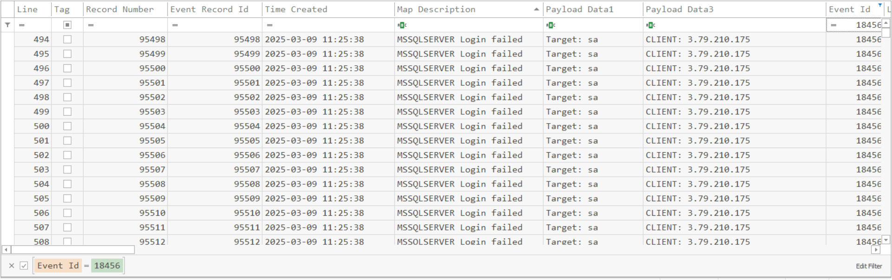

# MinerHunt Lab

### Scenario

CyberSecure Dynamics, a rapidly expanding technology services firm, has identified anomalous activity within its cloud-hosted SQL Server environment, attributed to outdated authentication configurations and weak default accounts. As an incident responder, your responsibility is to conduct a thorough investigation, analyze the relevant artifacts, reconstruct the timeline of events, identify exploited vulnerabilities and misconfigurations, and assess the full scope of the compromise—all while ensuring the confidentiality of specific attacker techniques.

### **Overview analysis**

Sau khi đọc kịch bản ta có thể thấy đây là một sự cố xảy ra trên môi trường SQL Server do điểm yếu trong cấu hình vậy ta có thể bắt đầu điều tra từ đây để có cái nhìn tổng quan trước khi bước vào trả lời các câu hỏi cụ thể

Trước hết tôi nghi ngờ attacker đã xâm nhập vào hệ thống từ SQL Server do điểm yếu trong cấu hình và 1 trong những cách để làm điều đó chính là brute force password hãy cùng xác minh điều đó qua Application log, nhưng trước hết để dễ dàng truy vấn Application log nói riêng hay các tệp log khác trong bài lab ta hãy sự dụng các tool trong bộ công cụ **ZimmermanTools,** sử dụng 2 công cụ là **EvtxEcmd** và **TimelineExplorer**

Sau đó filter EventID = 18456 “***SQL Server Event ID 18456 (“Login failed for user”) là lỗi xảy ra khi Microsoft SQL Server từ chối một kết nối do lỗi xác thực (authentication failure) trước khi phiên làm việc được thiết lập*”** ngược lại là Event ID 18454 đăng nhập thành công bạn có thể tham khảo thêm về các EventID về MSSQLSERVER: SQL Server qua [**link này](https://learn.microsoft.com/en-us/sql/relational-databases/errors-events/mssqlserver-18456-database-engine-error?view=sql-server-2017&utm_source=chatgpt.com).**

Ta có thể thấy một loạt nỗ lực brute force mật khẩu vào tài khoản System admin đến từ client 3.79.210.175 từ thời điểm “**2025-03-09 11:25:38 —> 2025-03-09 11:27:22”**

Sau những nỗ lực thì vào lúc 11:27:22 và 11:32:51 ghi nhận attacker đã đăng nhập thành công đồng nghĩa với việc đã xâm nhập vào được hệ thống.

Nhưng tới đây tôi lại không hiểu làm sao từ việc **Intial Access** qua MS SQL SERVER mà attacker có thể chuyển tới bước **Execution** nên tôi đã tìm hiểu một số tính năng của MS SQL SERVER có thể bị lợi dụng [***link](https://blog.hunterstrategy.net/suspicious-activity-involving-microsoft-sql-server/)*** có thể phát hiện thông qua truy vấn EventID=15457 (Cấu hình bị thay đổi)

***“xp_cmdshell”*** Là một Extended Stored Procedure cho phép thực thi bất kỳ câu lệnh dòng lệnh (OS Command) nào của hệ điều hành Windows ngay từ bên trong SQL và

Sau khi biết cách attacker xâm nhập vào hệ thống tôi muốn biết xem liệu hắn có mục đích gì và thực hiện mục đích đó bằng kĩ thuật gì hãy cùng tiếp đến với Sysmon Log sẽ cung cấp cho tôi nhiều EventID hữu ích trong việc theo dõi các hoạt động độc hại của attacker, bạn có thể tham khảo các EventID và ý nghĩa của chúng qua [***link này***](https://learn.microsoft.com/en-us/sysinternals/downloads/sysmon). Ở trong bài lab này tôi cũng sẽ nói qua một số EventID tôi thường chú ý khi điều tra.

Vì đã biết các xâm nhập ban đầu của attacker vì thế khi điều tra các event trong Sysmon tôi sẽ muốn biết tiếp theo attacker đã làm gì vì thế tôi sẽ để ý tới EventID=1 (Process create) 

Tôi phát hiện tiến trình gốc **sqlservr.exe** đang thực thi rất nhiều câu lệnh hãy cũng tôi khám phá xem ý nghĩa của từng câu lệnh

| Command | Mục đích |
| --- | --- |
| **`cmd /c systeminfo`** | Thu thập phiên bản Windows, bản vá, cấu hình hệ thống |
| **`cmd /c netstat -an`** | Liệt kê kết nối mạng và các cổng đang lắng nghe |
| **`cmd /c net user`** | Liệt kê tài khoản người dùng trên máy |
| **`taskkill /f /im <process_name>`** | Buộc các tiến trình được chỉ định kết thúc |

Vậy attacker đang cố discovery hệ thống cũng như tắt các ứng dụng bảo mật

Tiếp đến attacker đã tiếp tục tải xuống các file từ đây ta có các IoC như sau

| Loại | IOC |
| --- | --- |
| IP | `18.184.228.195` |
| Port | `8080/TCP` |
| URL | `http://18.184.228.195:8080/FM.txt` |
| URL | `http://18.184.228.195:8080/7zr.exe` |
| URL | `http://18.184.228.195:8080/XeX.7z` |
| URL | `http://18.184.228.195:8080/NF.bmof` |
| File | `C:\Temp\FM.exe` |
| File | `C:\Users\Public\xx.exe` |
| File | `C:\Users\Public\XeX.7z` |
| File | `C:\Users\Public\NF.bmof` |

Có thể nhận thấy attacker đang thực hiện Download → Decode → Extract Payload. Attacker sử dụng PowerShell để tải nhiều file từ máy chủ `18.184.228.195:8080` về máy nạn nhân. Đầu tiên, attacker tải `FM.txt` vào `C:\Temp`, sau đó sử dụng `certutil -decode` để giải mã file này thành chương trình thực thi `FM.exe` . Sau khi truy vấn Virustotal tôi được kết quả sau

**NetworkServiceExploit** là công cụ leo thang đặc quyền (Privilege Escalation) trên Windows, khai thác cơ chế Access Token và Token Impersonation để nâng quyền từ tài khoản dịch vụ lên tài khoản có quyền cao hơn. Attacker có thể sử dụng công cụ này để chiếm quyền kiểm soát hệ thống ở mức cao nhất

Tiếp theo, attacker tải công cụ giải nén `7zr.exe` (đổi tên thành `xx.exe`) và file nén `XeX.7z`, rồi sử dụng `xx.exe` để giải nén các thành phần bên trong vào `C:\Users\Public`. Ngoài ra, attacker còn tải `NF.bmof`, một file có thể liên quan đến việc thiết lập WMI persistence nhằm duy trì quyền truy cập trên hệ thống

Sau khi tải và giải mã attacker sử dụng **FM.exe** để thực thi file batch **N1F10.bat**. File batch này chứa hàng loạt lệnh nhằm tạo tài khoản backdoor, thiết lập quyền truy cập từ xa và làm suy yếu cơ chế bảo mật Windows

Sau đó attacker tiếp tục thi các lệnh nhầm duy trì quyền truy cập lâu dài

- Sử dụng **mofcomp** để biên dịch file **NF.bmof** đã tải trước đó, có khả năng đăng ký các thành phần WMI Event Subscription nhằm tự động thực thi mã độc khi điều kiện kích hoạt được đáp ứng
- Attacker  chỉnh sửa Registry tại **`HKLM\SOFTWARE\Microsoft\Windows NT\CurrentVersion\Image File Execution Options\svchost.exe`**, thêm giá trị **`Debugger`** trỏ đến file độc hại **`C:\Users\Public\XeX\services.exe`**

XMRig là phần mềm đào tiền mã hóa mã nguồn mở, thường được sử dụng để đào Monero (XMR) bằng tài nguyên CPU, khi attacker cài đặt và chạy XMRig trái phép trên máy nạn nhân, hành vi này được gọi là Cryptojacking.

Vậy giờ đã có gần như đủ dữ kiện để trả lời các câu hỏi của bài lab này

### Intial Access

#### Q1: The attacker attempts to gain access by compromising a privileged SQL Server account. Which MITRE ATT&CK ID corresponds to this credential access technique, and what specific account was targeted?

Như bài phân tích ở trên đã xuất hiện các nỗ lực brute force mật khẩu từ hời điểm “**2025-03-09 11:25:38 —> 2025-03-09 11:27:22”** vào tài khoản System Admin hay sa từ IP 3.79.210.175

**Answer**: T1110,sa

#### Q2: When was the last time the attacker successfully logged in or authenticated to the SQL Server using the compromised account?

Đã có 2 sự kiện xác nhận sự thành công trong việc brute force thành công của attacker

**Answer**: 2025-03-09 11:32

#### Q3: What was the source IP address used by the attacker when attempting to access the SQL Server?

Như ta đã xác định ở phân tích tổng quan cũng như ở 2 câu hỏi trước địa chỉ IP của attacker là

**Answer**: 3.79.210.175

### Execution

#### Q4: What is the full command executed to extract the contents of the archive downloaded from the attacker's machine?

Attacker đã tải xuống công cụ giải nén **7zr.exe** dưới cái tên xx.exe sau đó tải tiếp 1 tệp nén **XeX.7z** sau đó giải nén bằng câu lệnh

**Answer**: `C:\Users\Public\xx.exe  x C:\Users\Public\XeX.7z -oC:\Users\Public -y`

#### Q5: What is the name of the shell exploited by the attacker during the incident, and which MITRE ATT&CK technique identifier is associated with its misuse?

Như trên phân tích attacker đã thay đổi cấu hình MS SQL Server nhầm có thể thực thi các OS command

**Answer:** xp_cmdshell, T1059.003

#### Q6: After gaining initial access and launching a shell, a new process was spawned to execute commands. What is the Process ID (PID) of this process, and what is its full command-line?

Sau khi có được quyền truy cập ban đầu to có thể thấy attacker thực hiện hàng loạt các hành động discovery hệ thống từ tiến trình gốc `C:\Program Files\Microsoft SQL Server\MSSQL15.MSSQLSERVER\MSSQL\Binn\sqlservr.exe" -sMSSQLSERVER`

với PID là 6868

**Answer:** 6868, "C:\Program Files\Microsoft SQL Server\MSSQL15.MSSQLSERVER\MSSQL\Binn\sqlservr.exe" -sMSSQLSERVER

#### Q7: At what precise time did the attacker initiate modifications to the shell configuration utilized during the attack?

**Answer:** 2025-03-09 11:40

### Defense Evasion

#### Q8: The attacker attempts to evade detection using an ineffective method, but analyzing their attack sequence and skill level is crucial. Which antivirus vendor was the first to be targeted by the attacker?

Ở câu hỏi 7 ta thấy ngoài khám phá thì attacker còn tắt đi các tiến trình bảo mật ứng dụng và tiến trình đầu tiên bị tắt đi là **avp.exe**

**Answer**: Kaspersky

### Persistence

#### Q9: What is the full path of the **batch file** created by the attacker, which contains multiple commands essential to their attack, such as user account creation, privilege escalation, and system configuration modifications?

Sau khi tải và giải mã attacker sử dụng **FM.exe** để thực thi file batch **N1F10.bat**

**Answer:** C:\Users\Public\N1F10.bat

#### Q10: Which account did the attacker use for persistence, and in which registry path did they attempt to hide this account from the Windows login screen?

Câu trả lời có thể được nhận ra từ câu hỏi 9

**Answer:** Admin_env$, `HKLM\SOFTWARE\Microsoft\WindowsNT\CurrentVersion\Winlogon\SpecialAccounts\Userlist`

#### Q11: Which account did the attacker use for persistence, and in which registry path did they attempt to hide this account from the Windows login screen?

Như phân tích ở trên ta đã thấy attacker còn tải xuống tệp **NF.bmof** rồi sử dụng **mofcomp** để biên dịch, có khả năng đăng ký các thành phần WMI Event Subscription nhằm tự động thực thi mã độc khi điều kiện kích hoạt được đáp ứng

WMI Event Filter có tên **Daily23Filter**, nhằm kích hoạt một sự kiện vào 23h hằng ngày để phục vụ cơ chế Persistence

Tạo BatConsumer chứa VBScript thực thi C:\Users\Public\XeX\mi.bat

**Answer:** NF.bmof,BatConsumer,C:\Users\Public\XeX\mi.bat

#### Q12: What is the full registry key path where the attacker added the Debugger value to maintain persistence, and what is the exact data assigned to that value?

Attacker chỉnh sửa Registry tại `HKLM\SOFTWARE\Microsoft\Windows NT\CurrentVersion\Image File Execution Options\svchost.exe`, thiết lập giá trị **Debugger** trỏ đến file độc hại `C:\Users\Public\XeX\services.exe`. Khi Windows khởi chạy **svchost.exe** để vận hành các dịch vụ hệ thống, cơ chế IFEO sẽ chuyển hướng thực thi sang **services.exe**

### CA & PE

#### Q13: What is the full registry command executed by the attacker to modify Windows security settings and enable plaintext credential storage, aiding in credential theft?

Attacker thiết lập giá trị **UseLogonCredential** thành **1** nhằm kích hoạt khả năng lưu thông tin xác thực dạng plaintext trong bộ nhớ LSASS, tạo điều kiện cho attacker thu thập mật khẩu bằng các công cụ credential dumping như Mimikatz

**Answer:** reg add "HKLM\SYSTEM\CurrentControlSet\Control\SecurityProviders\WDigest" /v UseLogonCredential /t REG_DWORD /d 1 /f

#### **Q14: What is the complete file path of the encoded file that was later used to escalate privileges?**

Như đã phân tích attacker sử dụng PowerShell để tải **FM.txt** vào **C:\Temp**, sau đó sử dụng `certutil -decode` để giải mã file này thành chương trình thực thi **FM.exe**

**Answer:** C:\Temp\FM.txt

#### **Q15: It seems the attacker used a proof-of-concept privilege escalation tool for NetworkService that's available on GitHub. What is the full link to the GitHub repository for this tool?**

Sau khi đưa mã hash của FM.exe lên virustotal ta được kết quả như sau 

**Answer**: [**https://github.com/decoder-it/NetworkServiceExploit**](https://github.com/decoder-it/NetworkServiceExploit)

#### **Q16: What is the attacker's machine IP used for downloading files during the attack activities?**

Từ những câu hỏi trươc ta biết được ngay câu trả lời

**Answer**: 18.184.228.195

#### Q17: The attacker’s main objective seems to be the deployment of mining software. What is the MD5 hash of the miner?

**Answer:** f6d520ae125f03056c4646c508218d16