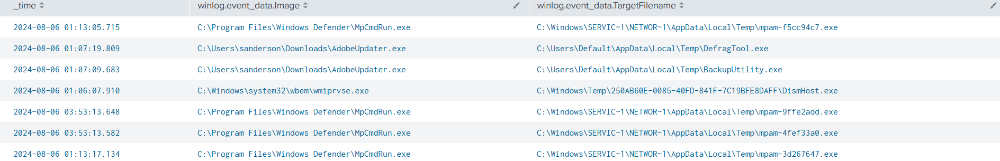

# ShadowRoast Lab

## **Scenario**

As a cybersecurity analyst at TechSecure Corp, you have been alerted to unusual activities within the company's Active Directory environment. Initial reports suggest unauthorized access and possible privilege escalation attempts.

Your task is to analyze the provided logs to uncover the attack's extent and identify the malicious actions taken by the attacker. Your investigation will be crucial in mitigating the threat and securing the network.

## **Questions**

### Q1: What's the malicious file name utilized by the attacker for initial access?

Splunk query: 

```jsx
index=shadowroast "event.code"=11 winlog.event_data.TargetFilename="*.exe"
| table _time, winlog.event_data.Image, winlog.event_data.TargetFilename
```



Answer: AdobeUpdater.exe

### Q2: What's the registry run key name created by the attacker for maintaining persistence?

Splunk query:

```jsx
index=shadowroast "event.code"=13 "Run"
| table _time, winlog.event_data.Image, winlog.event_data.TargetObject, winlog.event_data.Details
```


Answer: wyW5PZyF

### Q3: What's the full path of the directory used by the attacker for storing his dropped tools?

Splunk query:

```jsx
index=shadowroast "event.code"=11 "*\\AdobeUpdater.exe"
| table _time, winlog.event_data.Image, winlog.event_data.TargetFilename
```


Answer: C:\Users\Default\AppData\Local\Temp\

### Q4: What tool was used by the attacker for privilege escalation and credential harvesting?

Splunk query:

```jsx
index=shadowroast "event.code"=1 BackupUtility.exe
```


Answer: Rubeus

### Q5: Was the attacker's credential harvesting successful? If so, can you provide the compromised domain account username?

Splunk query:

```jsx
index=shadowroast "event.code"=4624 "winlog.event_data.LogonType"=3
```


Answer: tcooper

### Q6: What's the tool used by the attacker for registering a rogue Domain Controller to manipulate Active Directory data?

Splunk query:

```jsx
index=shadowroast "event.code"=1 tcooper  "winlog.event_data.CommandLine"="\"C:\\Users\\Default\\AppData\\Local\\Temp\\DefragTool.exe\"”
```


Answer: mimikatz

### Q7: What's the first command used by the attacker for enabling RDP on remote machines for lateral movement?

Splunk query:

```jsx
index=shadowroast "event.code"=1 tcooper
| table _time, winlog.event_data.ParentImage, winlog.event_data.ParentCommandLine,  winlog.event_data.ParentImage, winlog.event_data.CommandLine, winlog.event_data.CurrentDirectory
```


Answer:

```jsx
 "C:\Windows\system32\reg.exe" add "hklm\system\currentcontrolset\control\terminal server" /f /v fDenyTSConnections /t REG_DWORD /d 0
```

### Q8: What's the file name created by the attacker after compressing confidential files?

Splunk query:

```jsx
index=shadowroast "event.code"=11 ("*.zip" OR "*.rar" OR "*.7z" OR "*.tar")
```


