# Tax Day - BYOVD

### Scenario

Every year around tax season, accountants are buried in forms, filings, and contractor paperwork. Attackers know this. They count on the urgency, the routine, the muscle memory of downloading one more document. This time it worked.

### Overview analysis

#### 1. Truy cập ban đầu (Initial Access)

Khi tìm dấu vết Initial Access, tôi thường kiểm tra hai khả năng trước: người dùng vô tình tải nhầm file độc hại, hoặc attacker brute force để vào hệ thống. Kịch bản nhắc đến việc tải tài liệu thuế nên tôi bắt đầu với giả thuyết đầu tiên, xem `Event ID 15` để biết những file nào xuất hiện trong thư mục `Downloads`.

Từ `17:52` đến `18:12` ngày `30/04/2026`, log ghi nhận nhiều file thuế trong `C:\Users\kjones\Downloads`. Giữa các file PDF như **fw2vi.pdf**, **fw9.pdf**, **f1040es.pdf** và **fw4.pdf**, tôi thấy có một file tên **form_w9.msi** xuất hiện lúc `18:10:17`. Tên file gợi đến mẫu thuế W-9 nhưng phần mở rộng lại là `.msi`, nên tôi kiểm tra tiếp xem file này được tải từ đâu.

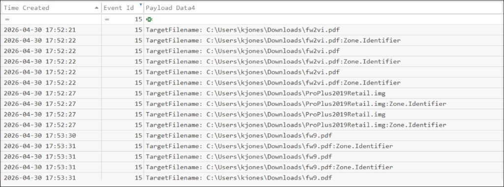

*Hình 1. Event ID 15 ghi nhận các file tải vào thư mục Downloads*

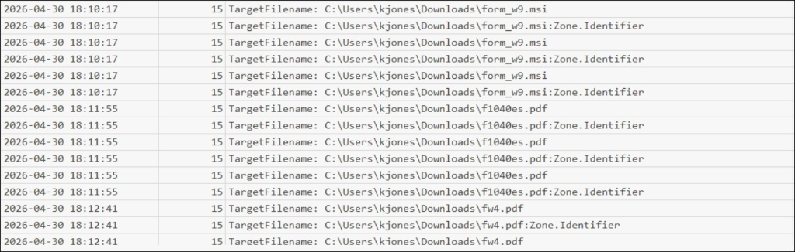

*Hình 2. Dòng TargetFilename ghi nhận form_w9.msi lúc 18:10:17*

Đối chiếu `target_path` với `referrer` trong dữ liệu trình duyệt, tôi thấy các file PDF đều có referrer từ `www.irs.gov`, còn **form_w9.msi** có referrer từ `bringetax.com`. Tôi tra domain này trên **VirusTotal** thì thấy `8/92` security vendors đánh dấu là malicious. Từ đây, tôi lần tiếp xem chuyện gì xảy ra sau khi **form_w9.msi** được tải về.

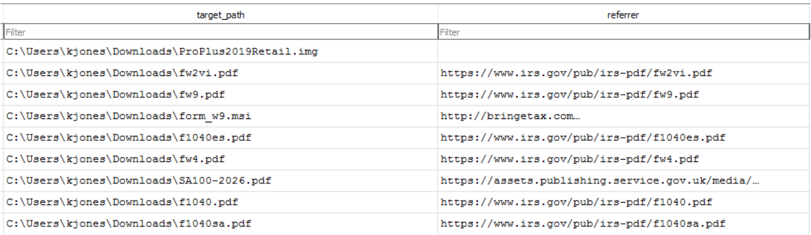

*Hình 3. Target path và referrer của các file tải xuống*

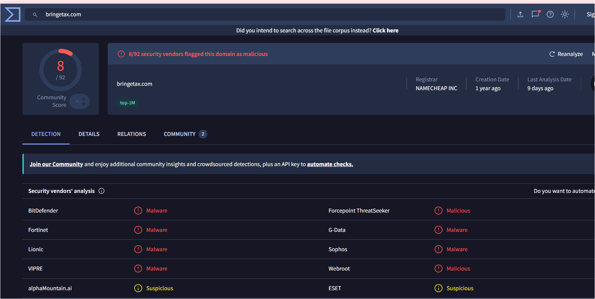

*Hình 4. Kết quả kiểm tra bringetax.com trên VirusTotal*

#### 2. Chạy file cài đặt và thiết lập công cụ điều khiển từ xa

Tôi xem tiếp `Event ID 1` để biết `kjones` đã mở gì sau khi tải các file. Lúc `18:14:34`, **msedge.exe** mở các file PDF trong thư mục `Downloads`. Sau đó 19 giây, lúc `18:14:53`, log ghi nhận **msiexec.exe** khởi chạy với tham số `/i` trỏ đến **form_w9.msi**, cho thấy file cài đặt MSI này đã được chạy.

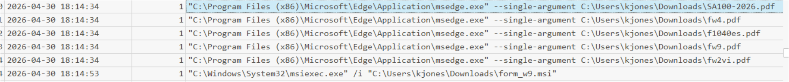

*Hình 5. Event ID 1 ghi nhận việc mở PDF và chạy form_w9.msi*

Theo dõi các tiến trình sinh ra từ bộ cài kết hợp với `Event ID 7045`, tôi thấy **form_w9.msi** đã cài lần lượt hai service truy cập từ xa: đầu tiên là **AteraAgent** lúc `18:15:47`, và sau đó là **Splashtop® Remote Service** lúc `18:18:23`.

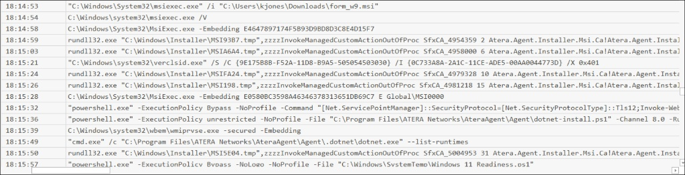

*Hình 6. Các tiến trình của installer sau khi form_w9.msi được mở*

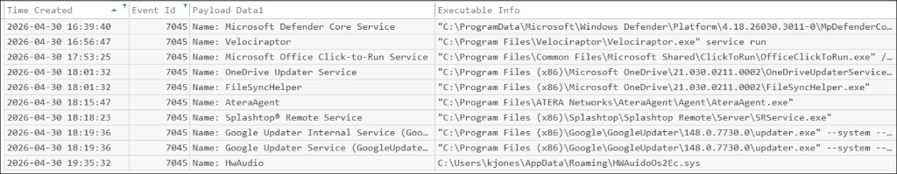

*Hình 7. Event ID 7045 ghi nhận service AteraAgent, Splashtop® Remote Service và HwAudio*


*Hình 8. Giao diện quản lý thiết bị đã cài agent. Ảnh từ [Atera Support](https://support.atera.com/hc/en-us/articles/215951197-The-Agent-Console).*

**AteraAgent** là agent RMM mà đội IT thường dùng để theo dõi và quản lý máy từ xa. Nếu bộ cài đã được cấu hình sẵn để đăng ký về tài khoản Atera của attacker, họ có thể dùng chính tính năng quản trị đó (cùng công cụ điều khiển đi kèm như Splashtop) để truy cập máy và chạy lệnh từ xa mà không cần tự viết C2 riêng. [Atera Support](https://support.atera.com/hc/en-us/articles/215951197-The-Agent-Console) · [CISA](https://www.cisa.gov/sites/default/files/2023-06/guide_to_securing_remote_access_software.pdf)

#### 3. Kiểm tra Registry và lần dump LSASS đầu tiên

Tìm hiểu tiếp về **AteraAgent**, tôi thấy agent dùng **AgentPackageRunCommandInteractive.exe** làm tiến trình cha để chạy lệnh tương tác trên máy. Lần theo `ParentCommandLine` của tiến trình này, tôi thấy **cmd.exe** được mở lúc `19:30:16`.

Trong phiên `cmd.exe` này, khóa Registry đầu tiên mà attacker truy vấn là `HKLM\System\CurrentControlSet\Control\Lsa` (`/v DisableRestrictedAdmin`) để kiểm tra trạng thái bảo vệ của LSA trước khi thao tác với credential. Sau khi kiểm tra và chỉnh thêm một vài khóa liên quan đến RDP (`Control\Terminal Server`), attacker mở **powershell.exe** lúc `19:32:21`.

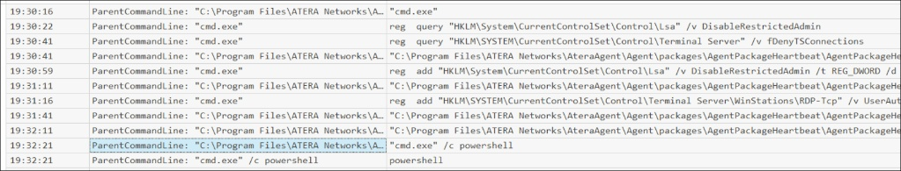

*Hình 9. Hoạt động trong ParentCommandLine cùng lệnh truy vấn Registry `Control\Lsa` và phiên PowerShell*

Tôi xem tiếp log Defender quanh mốc **PowerShell** vừa mở. Lúc `19:32:38`, tiến trình Defender (`PID 3504`) phát hiện `HackTool:PowerShell/Lsassdump.A` qua AMSI trong **powershell.exe**. Event ghi `Execution Name: Suspended`, `Action Name: Quarantine` và `Error Code: 0x00000000`, nghĩa là lần dump **LSASS** qua PowerShell đã bị chặn lại.

Hơn một phút sau, lúc `19:33:43`, attacker chạy lệnh `sc.exe stop WinDefend` để thử dừng trực tiếp dịch vụ Defender nhưng tiếp tục bị phát hiện dưới tên `Trojan:Win32/MpTamperSrvDisableAV.D`. Bản ghi `Event ID 1117` (`EventRecordID 2032`, `PID 3504`) lúc `19:34:39` cho thấy Defender đã xử lý chặn thành công (`Action Name: Remove`, `Error Code: 0x00000000`) sau khoảng 56 giây. Vì cả hai cách trên đều không qua được, attacker chuyển sang hướng khác để tắt Defender.

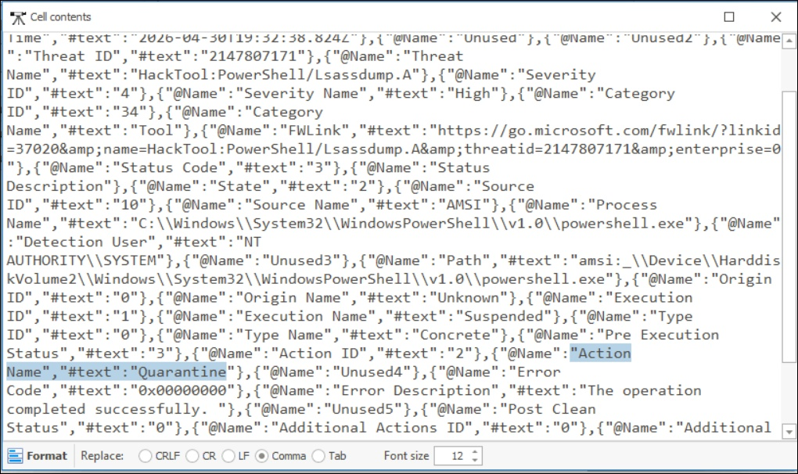

*Hình 10. Defender ghi nhận Suspended và Quarantine cho detection qua AMSI*

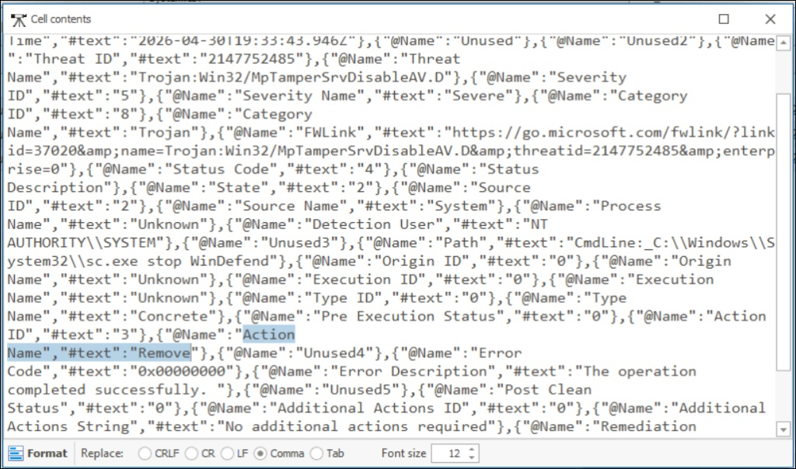

*Hình 11. Defender ghi nhận Remove cho detection liên quan đến lệnh `sc.exe stop WinDefend`*

#### 4. Thả driver để tắt Windows Defender

Sau khi bị chặn hai lần, attacker mở một phiên PowerShell tương tác và thả hai file mới vào `C:\Users\kjones\AppData\Roaming`: **HWAuidoOs2Ec.sys** xuất hiện lúc `19:35:13`, còn **kd.exe** xuất hiện lúc `19:35:20`. Đến `19:35:32`, `Event ID 7045` (đã thấy ở Hình 7) ghi nhận một kernel service mới tên **HwAudio** được cài và trỏ thẳng tới file `.sys` này.

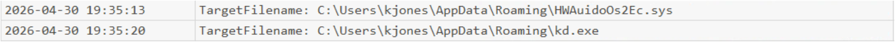

*Hình 12. Hai file HWAuidoOs2Ec.sys và kd.exe xuất hiện trong AppData\Roaming*

Để xem **kd.exe** có chạy hay không, tôi mở **WinPrefetchView**. File Prefetch **KD.EXE-56679BDE.pf** ghi nhận `Run Counter` bằng `3`, với lần chạy đầu tiên lúc `19:35:51` và hai lần sau lúc `19:36:42`, `19:37:26`.

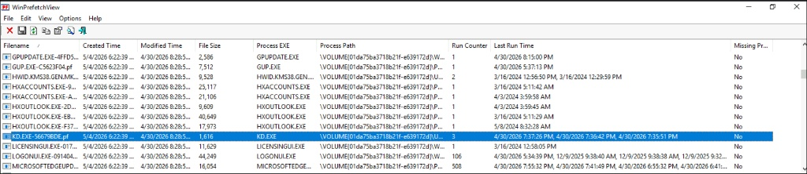

*Hình 13. Run Counter và các mốc chạy của kd.exe trong WinPrefetchView*

Tôi mở **kd.exe** trong **IDA** để xem chương trình này làm gì. Trong hàm `main`, chuỗi `MsMpEng.exe` (tiến trình chính của Defender) được truyền vào `GetPidByName`. Ở nhánh tiếp theo, chương trình gọi `DeviceIoControl` với mã IOCTL `0x2248DC` (`2248DCh`) kèm chuỗi thông báo gửi yêu cầu tới driver Huawei để kết thúc tiến trình đích. Ghép với service **HwAudio** vừa cài trước đó, có thể thấy **kd.exe** giao tiếp với driver **HWAuidoOs2Ec.sys** qua mã IOCTL này để tắt tiến trình của Defender.

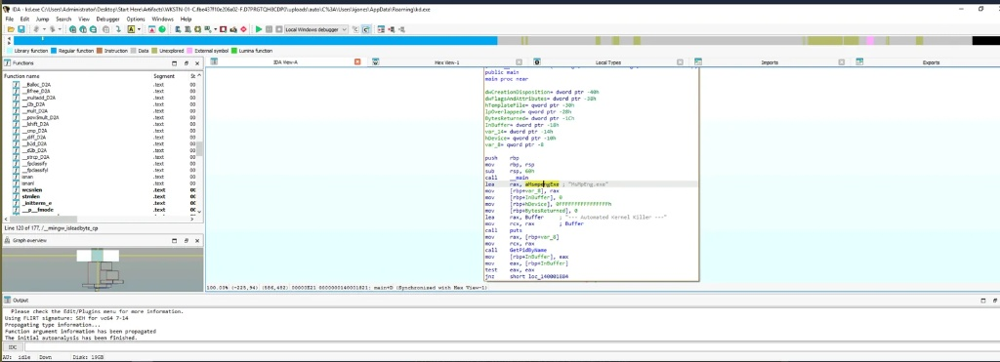

*Hình 14. Hàm main của kd.exe tìm PID của MsMpEng.exe*

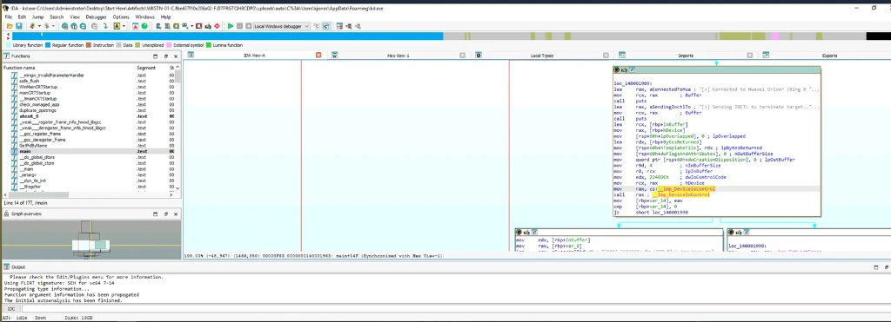

*Hình 15. Lời gọi DeviceIoControl với mã IOCTL 0x2248DC trong nhánh gửi yêu cầu kết thúc tiến trình*

#### 5. Lần dump LSASS thứ hai và diễn biến của Windows Defender

Quay lại log tiến trình quanh mốc chạy đầu tiên của **kd.exe** (`19:35:51`), tôi thấy lúc `19:36:06` — tức 15 giây sau — **rundll32.exe** chạy dưới quyền `NT AUTHORITY\SYSTEM`, gọi hàm `MiniDump` từ **comsvcs.dll**, nhắm vào PID `684` và tạo file đầu ra `C:\Users\kjones\AppData\Roaming\lsass.dmp` (`CreationUtcTime: 19:36:06.283`).

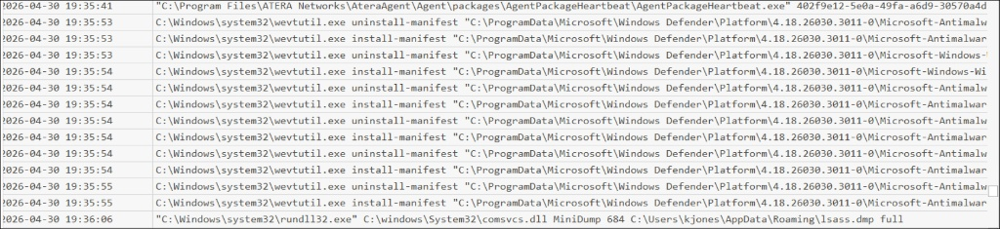

*Hình 16. Log tiến trình ghi nhận MiniDump với đầu ra lsass.dmp*

<details>
<summary>Bản ghi tạo file lsass.dmp</summary>

```json
{
  "EventData": {
    "Data": [
      {
        "@Name": "RuleName",
        "#text": "-"
      },
      {
        "@Name": "UtcTime",
        "#text": "2026-04-30 19:36:06.284"
      },
      {
        "@Name": "ProcessGuid",
        "#text": "c73af8d8-af26-69f3-2a0b-000000005400"
      },
      {
        "@Name": "ProcessId",
        "#text": "4648"
      },
      {
        "@Name": "Image",
        "#text": "C:\\Windows\\system32\\rundll32.exe"
      },
      {
        "@Name": "TargetFilename",
        "#text": "C:\\Users\\kjones\\AppData\\Roaming\\lsass.dmp"
      },
      {
        "@Name": "CreationUtcTime",
        "#text": "2026-04-30 19:36:06.283"
      },
      {
        "@Name": "User",
        "#text": "NT AUTHORITY\\SYSTEM"
      }
    ]
  }
}
```

</details>

Xem đầy đủ log `Event ID 1116` (Hình 17) và đối chiếu với `Event ID 1117` cùng 3 mốc chạy của **kd.exe** trong Prefetch, tôi thấy rõ chuyện gì đã xảy ra với Defender và file **lsass.dmp**.

Lần chạy **kd.exe** đầu tiên lúc `19:35:51` chưa kết thúc được tiến trình Defender hiện tại (`PID 3504`), nên khi `rundll32.exe` tạo `lsass.dmp` lúc `19:36:06`, `PID 3504` vẫn phát hiện `Trojan:Win32/LsassDump.A` trên file này (`Event ID 1116` lúc `19:36:22`, kèm cảnh báo hành vi `Behavior:Win32/LsassDump.E` trước đó). Tuy nhiên, 20 giây sau (`19:36:42`), attacker chạy **kd.exe** lần 2 và kết thúc được `PID 3504` trước khi nó kịp cách ly file (ở lần chặn `sc.exe stop WinDefend` trước đó, Defender mất khoảng 56 giây mới ghi xong `Event ID 1117`).

Sau khi bị dừng, dịch vụ `WinDefend` tự khởi động lại và quét trúng `lsass.dmp` đang nằm trên đĩa, ghi nhận `Event ID 1116` lần thứ hai lúc `19:37:22`. Chỉ 4 giây sau (`19:37:26`), attacker chạy **kd.exe** lần 3 để tiếp tục tắt tiến trình Defender vừa chạy lại. Đến khi `WinDefend` tự khởi động lại lần nữa dưới tiến trình mới **`PID 8972`**, hệ thống phát hiện `lsass.dmp` lần thứ ba (`Detection Time: 19:38:39`, `Time Created: 19:38:55` trong `Event ID 1116`, `Source Name: System`, `Process Name: Unknown`). Vì không còn `kd.exe` chạy thêm sau mốc `19:37:26`, `PID 8972` lần này hoàn tất cách ly file (`Event ID 1117`, `EventRecordID 2061`, `Action Name: Quarantine`, `Error Code: 0x00000000`) lúc `19:39:24`.

Chuỗi log này cũng giải thích vì sao `kd.exe` có `Run Counter = 3`: mỗi lần Defender tự chạy lại và phát hiện file dump, attacker lại chạy `kd.exe` để tắt Defender thêm một lần. Nhờ vậy, file **lsass.dmp** đã được tạo ra đĩa và tồn tại liên tục trong **3 phút 18 giây** (`19:36:06` – `19:39:24`), đủ thời gian để attacker đọc hoặc lấy file ra trước khi bị cách ly.

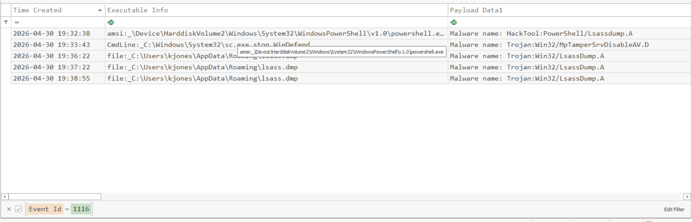

*Hình 17. Danh sách đầy đủ Event ID 1116 ghi nhận 3 lần phát hiện đối với file lsass.dmp*

| Thời gian (UTC) | Sự kiện | PID Defender | Ghi chú |
| --- | --- | --- | --- |
| `19:33:43` | Event 1116 (`MpTamperSrvDisableAV.D`) | `3504` | Phát hiện lệnh `sc.exe stop WinDefend`. |
| `19:34:39` | Event 1117 (`Remove` — Thành công) | `3504` | Chặn xong lệnh dừng Defender (sau ~56 giây). |
| `19:35:51` | `kd.exe` chạy lần 1 (Prefetch) | — | Chưa kết thúc được `PID 3504`. |
| `19:36:06` | `rundll32.exe` tạo `lsass.dmp` | `3504` | `rundll32.exe` dùng `comsvcs.dll` (`MiniDump`) tạo `lsass.dmp`. |
| `19:36:22` | Event 1116 (Lần 1) | `3504` | `PID 3504` phát hiện `Trojan:Win32/LsassDump.A` trên `lsass.dmp`. |
| `19:36:42` | `kd.exe` chạy lần 2 (Prefetch) | — | Chạy sau cảnh báo 20 giây, dừng được `PID 3504` trước khi kịp cách ly. |
| `19:37:22` | Event 1116 (Lần 2) | — | `WinDefend` tự chạy lại và phát hiện lại `lsass.dmp`. |
| `19:37:26` | `kd.exe` chạy lần 3 (Prefetch) | — | Chạy sau cảnh báo 4 giây, tiếp tục dừng tiến trình Defender mới. |
| `19:38:39` → `19:38:55` | Event 1116 (Lần 3) | `8972` | Tiến trình Defender mới (`PID 8972`) chạy lại và phát hiện `lsass.dmp`. |
| `19:39:24` | Event 1117 (`Quarantine`) | `8972` | Không còn `kd.exe` chạy thêm, `PID 8972` cách ly xong `lsass.dmp`. |

---

### Câu hỏi và đáp án (Questions & Answers)

**Q1:** While searching and downloading tax forms, `kjones` certainly downloaded a file that doesn't fit what he was looking for. What is the name of that file?
* **Đáp án:** `form_w9.msi`
* **Giải thích:** Giữa các file thuế PDF được tải về thư mục `Downloads` (`Event ID 15`), xuất hiện một file cài đặt Windows Installer tên `form_w9.msi`.

**Q2:** What time was that file downloaded?
* **Đáp án:** `2026-04-30 18:10`
* **Giải thích:** `Event ID 15` ghi nhận `C:\Users\kjones\Downloads\form_w9.msi` được tạo lúc `2026-04-30 18:10:17`.

**Q3:** What domain was that file downloaded from?
* **Đáp án:** `bringetax.com`
* **Giải thích:** Dữ liệu lịch sử tải xuống của trình duyệt ghi nhận `referrer` của `form_w9.msi` là `http://bringetax.com...`.

**Q4:** At some point `kjones` opened the files he downloaded, which triggered the execution of the rogue file. When exactly did that happen?
* **Đáp án:** `2026-04-30 18:14`
* **Giải thích:** `Event ID 1` ghi nhận `msiexec.exe /i "C:\Users\kjones\Downloads\form_w9.msi"` chạy lúc `2026-04-30 18:14:53`.

**Q5:** The execution of that file immediately triggered a chain of events leading to the installation of a remote management tool. A new service was registered on the system shortly after. What is the name of that service?
* **Đáp án:** `AteraAgent`
* **Giải thích:** `Event ID 7045` ghi nhận service `AteraAgent` được cài đặt lúc `2026-04-30 18:15:47`.

**Q6:** The same installation also deployed a second remote access tool. What is the service name registered for this second tool?
* **Đáp án:** `Splashtop® Remote Service`
* **Giải thích:** `Event ID 7045` ghi nhận thêm service `Splashtop® Remote Service` được cài kèm ngay sau đó lúc `2026-04-30 18:18:23`.

**Q7:** After gaining access, the attacker started discovery activity through the RMM. There is a specific process belonging to the RMM agent that acted as the parent to all subsequent attacker commands on the system. What is the name of that process?
* **Đáp án:** `AgentPackageRunCommandInteractive.exe`
* **Giải thích:** Xem `ParentCommandLine` trong log tiến trình thì thấy `AgentPackageRunCommandInteractive.exe` của AteraAgent là process cha chạy `cmd.exe` và các lệnh sau đó của attacker.

**Q8:** The attacker queried registry keys to check the current state of the system before making any changes. What was the first registry key they queried?
* **Đáp án:** `HKLM\System\CurrentControlSet\Control\Lsa`
* **Giải thích:** Lệnh đầu tiên chạy từ `cmd.exe` lúc `19:30:22` là `reg query "HKLM\System\CurrentControlSet\Control\Lsa" /v DisableRestrictedAdmin`.

**Q9:** The attacker then attempted to dump LSASS to steal credentials but was immediately blocked by Defender. When did Defender first detect this attempt?
* **Đáp án:** `2026-04-30 19:32`
* **Giải thích:** Log Defender ghi nhận phát hiện `HackTool:PowerShell/Lsassdump.A` qua AMSI lúc `2026-04-30 19:32:38`.

**Q10:** Failing to dump LSASS, the attacker tried to stop Defender directly but was also blocked. What exact command did the attacker run to attempt this?
* **Đáp án:** `sc.exe stop WinDefend`
* **Giải thích:** Cảnh báo `Trojan:Win32/MpTamperSrvDisableAV.D` lúc `19:33:43` ghi nhận dòng lệnh `C:\Windows\System32\sc.exe stop WinDefend`.

**Q11:** With both attempts blocked, the attacker launched an interactive PowerShell session and dropped two files into the system. What are the names of those two files?
* **Đáp án:** `HWAuidoOs2Ec.sys, kd.exe`
* **Giải thích:** Log tạo file ghi nhận hai file này xuất hiện trong `C:\Users\kjones\AppData\Roaming` lúc `19:35:13` và `19:35:20`.

**Q12:** The attacker then registered one of those dropped files as a kernel service. What name did the attacker give to that service?
* **Đáp án:** `HwAudio`
* **Giải thích:** `Event ID 7045` lúc `19:35:32` ghi nhận service mới tên `HwAudio` trỏ tới `C:\Users\kjones\AppData\Roaming\HWAuidoOs2Ec.sys`.

**Q13:** One of the two dropped files was an executable designed to kill Windows Defender. When was it executed for the first time?
* **Đáp án:** `2026-04-30 19:35`
* **Giải thích:** File Prefetch (`KD.EXE-56679BDE.pf`) trong `WinPrefetchView` cho thấy `kd.exe` chạy lần đầu lúc `2026-04-30 19:35:51`.

**Q14:** Load that executable in IDA. What is the process name this executable targets?
* **Đáp án:** `MsMpEng.exe`
* **Giải thích:** Mở `kd.exe` trong IDA, hàm `main` truyền chuỗi `MsMpEng.exe` vào `GetPidByName`.

**Q15:** Continue your analysis in IDA. The executable communicates with the loaded driver by sending it a specific control code. What is the IOCTL code passed to `DeviceIoControl`?
* **Đáp án:** `0x2248DC`
* **Giải thích:** Trong IDA, tham số `dwIoControlCode` (`edx`) truyền vào `DeviceIoControl` có giá trị `2248DCh` (`0x2248DC`).

**Q16:** With Defender neutralized, the attacker successfully dumped LSASS. When was the dump file created on disk?
* **Đáp án:** `2026-04-30 19:36`
* **Giải thích:** Log tạo file xác nhận `C:\Users\kjones\AppData\Roaming\lsass.dmp` được `rundll32.exe` ghi ra đĩa lúc `2026-04-30 19:36:06`.

---

### Danh sách IOC

| Loại | IOC | Ghi chú |
| --- | --- | --- |
| Domain | `bringetax.com` | Domain trong `referrer` của **form_w9.msi**, bị `8/92` vendor trên VirusTotal đánh dấu malicious. |
| File | `C:\Users\kjones\Downloads\form_w9.msi` | File cài đặt giả mạo mẫu thuế W-9, xuất hiện lúc `18:10:17` (`Event ID 15`) và chạy qua `msiexec.exe` lúc `18:14:53`. |
| Service | `AteraAgent` | Service RMM được cài lúc `18:15:47` (`Event ID 7045`), dùng để chạy lệnh từ xa. |
| Service | `Splashtop® Remote Service` | Service truy cập từ xa thứ hai được cài kèm lúc `18:18:23` (`Event ID 7045`). |
| File | `C:\Users\kjones\AppData\Roaming\HWAuidoOs2Ec.sys` | File driver được thả lúc `19:35:13`, đăng ký dưới tên service `HwAudio` lúc `19:35:32`. |
| File | `C:\Users\kjones\AppData\Roaming\kd.exe` | File thực thi được thả lúc `19:35:20`, chạy 3 lần (`19:35:51`, `19:36:42`, `19:37:26`), nhắm vào `MsMpEng.exe` qua IOCTL `0x2248DC`. |
| File | `C:\Users\kjones\AppData\Roaming\lsass.dmp` | File dump LSASS do `rundll32.exe` tạo lúc `19:36:06` và bị tiến trình Defender mới (`PID 8972`) cách ly lúc `19:39:24`. |
